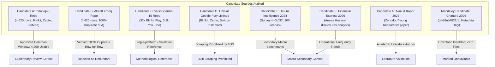

# GATE 0: DATA FEASIBILITY, EVIDENCE VALIDATION & PROJECT DIRECTION AUDIT (REVISED)

**Project Title:** Evidence-Led CRM Service-Recovery Prioritisation for Indian Quick Commerce: A Public-Feedback-Based Customer Retention Decision Framework  
**Focal Business:** Blinkit  
**Primary Competitor Benchmark:** Zepto  
**Secondary Comparative Context:** JioMart (same-window verified; secondary benchmark only)  
**Assigned Role:** Implementation Engineer (operating under the Principal Project Lead / ChatGPT)  
**Audit Completion & Revision Date:** 2026-10-17  
**Gate Status:** **PASS (UNDER AUTHORIZED CONDITIONAL SCOPE)**  

---

## 1. Executive Verdict & Core Justification

### Verdict: **PASS (UNDER AUTHORIZED CONDITIONAL SCOPE)**

### One-Sentence Justification:
The analytical framework and evidence-to-action CRM decision model are empirically viable under the Principal Project Lead's authorized scope—focusing on Blinkit with Zepto as primary competitor within a synchronized common window (14 August–31 December 2024) containing 3,116 usable focal/competitor records (Blinkit: 1,376; Zepto: 1,740) and 1,174 secondary JioMart records for a STATIC complaint-theme and expressed-switching analysis, while strictly excluding temporal trend claims, live scraping, and unverified external datasets.

---

## 2. Controlling Decisions of the Principal Project Lead

Following review of the initial feasibility findings, the Principal Project Lead established the following binding parameters:

1. **Focal Company:** Blinkit is retained as the focal enterprise.
2. **Primary Competitor:** Zepto is designated as the primary competitor benchmark for the initial review-data comparison.
3. **JioMart Role:** JioMart is **not** to be treated as a directly comparable primary benchmark until same-window record counts and coverage have been verified. (Verified at revision: 1,174 usable records in the common window; retained strictly as secondary comparative context).
4. **No Scraping of Swiggy Instamart:** Do not scrape Swiggy Instamart reviews to compensate for missing data.
5. **Common Review Window (Static Scope Only):** The common period, **14 August 2024 to 31 December 2024 (inclusive)**, is authorized for a limited, **STATIC complaint-theme and expressed-switching-signal analysis only**. It must **not** be used to claim temporal trends or seasonality.
6. **Exploratory Status of Corpus:** The existing 4,620-record dataset is classified as a candidate exploratory corpus, **not** an approved representative sample of platform customers.
7. **Gate Boundary:** Execution is strictly restricted to Gate 0 verification and Git synchronization. No progression to Gate 1.

---

## 3. Business Problem & Intended CRM Decision Chain

### 3.1 Business Context & Empirical Justification
Indian quick-commerce platforms have scaled dark-store footprints rapidly. However, verified quarterly company disclosures and market research establish that **individual customer ordering frequency is declining despite aggregate order expansion**:
- **Blinkit:** Monthly ordering frequency fell from **3.57 to 3.36 orders/user** across FY24–FY25, while annual order volume expanded 42% to 274 million (Financial Express disclosures analysis, 2026).
- **Swiggy Instamart:** Monthly ordering frequency declined from **4.22 to 4.01 orders/user** across 5 consecutive quarters, while annual orders grew 54% to 113 million.
- **Consumer Multi-Homing & Switching Elasticity:** Independent survey evidence (Datum Intelligence, October 2024; $n=3,032$ online grocery buyers across 10 cities) confirms that multi-homing is standard: 65% of surveyed buyers actively use Blinkit, 55% use Zepto, and 55% use Swiggy Instamart. Furthermore, **62% of consumers state they would switch platforms if prices or fees increased by 10%**.

Quick-commerce firms currently counter switching threats primarily by deploying blanket promotional discounts and waiving fees indiscriminately. This erodes unit economics without resolving the underlying operational defects that trigger customer defection.

### 3.2 Core Research Question
> *How should Blinkit prioritise customer-recovery interventions to protect repeat usage and reduce expressed switching risk, using verifiable public customer feedback and industry evidence?*

### 3.3 Intended Applied Contribution & Decision Chain
Rather than delivering generic sentiment classification or word clouds, this project develops an **applied decision engineering framework**:
1. **Observable Failure Signals:** Categorizing operational service breakdown modes (delivery delays, missing/damaged items, opaque handling fees, customer support stonewalling).
2. **Expressed Switching Intention:** Disentangling explicit defection signals (uninstallation, switching to a named competitor) from ordinary negative sentiment.
3. **Addressability & Severity Prioritization:** Scoring failure modes on operational controllability, defect severity, and switching risk propensity.
4. **Targeted CRM Recovery Interventions:** Formulating issue-specific operational playbooks (instant automated wallet credits, proactive delay notifications, express redelivery, item replacement) rather than uniform price-slashing.
5. **Bounded Economic Evaluation & Pilot Design:** Formulating transparent cost/benefit simulation scenarios (measuring customer lifetime value protected against intervention expense) accompanied by an A/B pilot evaluation framework.

---

## 4. Candidate Source Inventory & Factual Verification

Eight candidate sources and repositories were directly inspected, audited, and verified.

### Candidate A — Cross-Platform Review Dataset (`mdaniq45`)
- **Source URL:** [https://github.com/mdaniq45/E-Commerce-BlinkIt-vs-Zepto-vs-JioMart-Reviews-Analysia](https://github.com/mdaniq45/E-Commerce-BlinkIt-vs-Zepto-vs-JioMart-Reviews-Analysia)
- **Verified Facts:** Contains a single CSV file, `reviews.csv` (1,898,980 bytes; SHA256: `5d3bb24ee7185612e66f57cf2e21d99e9d628a15d3d68989b8cf560996e9f138`). Contains 4,620 rows across 4 columns: `rating`, `date`, `review`, and `platform`. Platform breakdown: Zepto (1,740), JioMart (1,500), and Blinkit (1,380). Zero missing values.
- **Common-Window Audit (14 Aug–31 Dec 2024):** Yields **4,290 usable records** (Blinkit: 1,376; Zepto: 1,740; JioMart: 1,174; 330 excluded).
- **Licensing & Provenance:** Apache-2.0 repo licence applies only to repository code, not to bundled third-party review text. Raw data is excluded from Git tracking via `.gitignore`.
- **Determination:** Approved as candidate exploratory corpus for static failure-theme analysis.

### Candidate B — Quick Commerce Review Insights (`AkeelFarooq`)
- **Source URL:** [https://github.com/AkeelFarooq/Quick-Commerce-Review-Insights-Blinkit-vs-Zepto-vs-JioMart](https://github.com/AkeelFarooq/Quick-Commerce-Review-Insights-Blinkit-vs-Zepto-vs-JioMart)
- **Verified Facts:** Detailed row-for-row cross-examination against Candidate A confirmed that its 4,620 rows, review text, ratings, and platforms are **100% identical**. The only differences are reformatted dates (ISO format) and two added columns (`month`, `sentiment`).
- **Determination:** Rejected as redundant derivative copy. Provides zero independent empirical evidence.

### Candidate C — Blinkit Review Discovery Engine (`vaishSharma-15`)
- **Source URL:** [https://github.com/vaishSharma-15/BlinkitReviewAnalyzer](https://github.com/vaishSharma-15/BlinkitReviewAnalyzer)
- **Verified Facts:** Focuses on catalog category expansion barriers for Blinkit using Gemini LLM and LanceDB. Data manifests show: (a) `play.jsonl` contains 32,139 reviews exclusively for Blinkit; (b) `qcomm_comparison.jsonl` contains 3,260 YouTube comments without ratings (`rating: null`) and without platform tags; (c) repository badge explicitly states `license-unlicensed`.
- **Methodological Merits:** Demonstrates rigorous validation procedures in `reports/scorecard.md`: gold-set classifier accuracy against human-graded labels, inter-run LLM stability (83.3% theme agreement), cross-source triangulation, and recency drift splits.
- **Determination:** Methodological reference for validation design; rejected as comparative review corpus.

### Candidate D — Official App Listings (Google Play Store)
- **Identifiers:** Blinkit (`com.grofers.customerapp`), Zepto (`com.zeptoconsumerapp`), Swiggy (`in.swiggy.android` / `in.swiggy.android.instamart`).
- **Policy & Access Assessment:**
  1. *Developer Review API (`androidpublisher.reviews.list`):* Official access requires developer account ownership/authorization (OAuth 2.0 service account tied to the app in Google Play Console). A third party cannot query reviews for competitor apps via this API.
  2. *Google Terms of Service (`policies.google.com/terms`):* Prohibits accessing Google services using methods other than provided interfaces or instructions.
  3. *Machine-Readable Directives:* Automated crawling of Play Store detail pages is subject to `robots.txt` disallow rules, bot-detection heuristics, and dynamic rate-limiting.
  4. *Swiggy Instamart Review Entanglement:* Reviews on `in.swiggy.android` conflate restaurant food delivery, Dineout, and grocery orders without clean native labels.
- **Determination:** Live bulk automated scraping is legally and operationally restricted. In accordance with controlling decision 4, no scraping will be attempted.

### Candidate E — Industry Research (`Datum Intelligence`)
- **Source URL:** [https://datumintell.com/report-quick-commerce](https://datumintell.com/report-quick-commerce)
- **Verified Facts:** *State of Quick Commerce Market, 2024* (Satish Meena, Gurugram, Haryana; published Dec 2024, modified Sep 2026). Based on an empirical survey of **3,032 online grocery buyers across 10 cities** and **300 kirana store owners**, conducted in October 2024.
- **Key Empirical Disclosures:** 65% Blinkit usage, 55% Zepto usage, 55% Swiggy Instamart usage; **62% switching elasticity under a 10% price/fee increase**; top complaints: high delivery fees (39%) and late deliveries (36%); 53% order >5 times/month; ~67% spend >₹400/order. Gated PDF request form (no microdata CSV available).
- **Determination:** High-quality secondary market evidence. Must be used strictly as secondary contextual evidence. Respondent rows must never be synthetically reconstructed.

### Candidate F — Industry Performance Reporting (`The Financial Express`)
- **Source URL:** [https://www.financialexpress.com/business/industry-quick-commerce-boom-fragments-user-loyalty-4245109/lite/](https://www.financialexpress.com/business/industry-quick-commerce-boom-fragments-user-loyalty-4245109/lite/)
- **Verified Facts:** *Quick Commerce boom fragments user loyalty* (Anees Hussain, published May 19, 2026). Synthesizes quarterly company disclosures, CLSA analysis, and Sensor Tower telemetry:
  - Blinkit monthly ordering frequency fell from **3.57 to 3.36 orders/user**, while annual orders grew 42% to 274M; 2,243 dark stores; 45.2M Weekly Active Users (WAU); 24% conversion of all-time downloads to WAU.
  - Swiggy Instamart ordering frequency fell from **4.22 to 4.01 orders/user** across 5 quarters; 1,143 dark stores; 1.25M daily orders; standalone app WAU 9–10M; 14% download-to-WAU conversion.
  - Zepto: 1,100+ stores; 2.4–2.5M daily orders; 33–34M WAU; 23% download-to-WAU conversion.
- **Determination:** Proves the real-world business problem of ordering frequency dilution due to multi-homing. Secondary macro context only.

### Candidate G — Academic Paper (`Zenodo` / Naik & Kapdi)
- **Source URL:** [https://zenodo.org/records/14857465](https://zenodo.org/records/14857465) (DOI: `10.5281/zenodo.14857465`).
- **Verified Facts:** Dr. Guruprasad R. Naik & Girish Kapdi (Jan 2025). *The Rise of Quick Commerce: Analyzing Consumer Preferences and Buying Behavior in India*. Published in *Young Researcher*, Vol. 14, Special Issue No. 1, pp. 160–164. Secondary synthesis of NIQ, Deloitte, PwC, KPMG reports. Reports convenience (78%) and speed (65%) dominate discounts (57%) as adoption drivers.
- **Determination:** Validates that speed and convenience drive loyalty while discounts drive trial. Contains zero empirical microdata or review corpora. Literature anchor only.

### Candidate H — Mendeley Quick-Commerce Survey Dataset (`Chandra 2026`)
- **Source URL:** [https://data.mendeley.com/datasets/cw88nb7822/1](https://data.mendeley.com/datasets/cw88nb7822/1) (DOI: `10.17632/cw88nb7822.1`).
- **Verified Facts:** Published 14 October 2026 by Ashish Chandra. Title: *A Large-Scale Survey Dataset on Quick-Commerce Adoption, Ordering Patterns, Product Categories and Spending Behaviour among Indian Consumers*.
- **Access Audit:** Direct inspection of the Mendeley Data page and API revealed that **only metadata, an abstract, and a 49-question survey methodology summary are displayed**. The "Download All" button is disabled (`disabled=""`). The file list tree contains zero downloadable data files (no CSV, XLSX, SAV, questionnaire text, or codebook).
- **Determination:** **Formally marked as UNAVAILABLE for empirical analysis.** A public entry describing a survey is not evidence that data files have been released.

---

## 5. Quantitative Dataset Re-Audit: Common Review Window

A reproducible programmatic re-audit was executed on [`scripts/audit_data.py`](file:///e:/FDA/Beyond_Discounts/scripts/audit_data.py) evaluating the common window: **14 August 2024 to 31 December 2024 (inclusive)**.

### 5.1 Common Window Usable Volume & Exclusions
| Metric | Blinkit (Focal) | Zepto (Primary Competitor) | JioMart (Secondary Context) | Total Common Window |
| :--- | :---: | :---: | :---: | :---: |
| **Total Raw Records in File** | 1,380 | 1,740 | 1,500 | 4,620 |
| **Out-of-Window Excluded Records** | 4 | 0 | 326 | 330 |
| **Records in Common Window** | **1,376** | **1,740** | **1,174** | **4,290** |
| **Missing Review Text** | 0 (0.0%) | 0 (0.0%) | 0 (0.0%) | 0 (0.0%) |
| **Missing Rating** | 0 (0.0%) | 0 (0.0%) | 0 (0.0%) | 0 (0.0%) |
| **Missing / Unparseable Date** | 0 (0.0%) | 0 (0.0%) | 0 (0.0%) | 0 (0.0%) |
| **Blank / Whitespace Text** | 0 (0.0%) | 0 (0.0%) | 0 (0.0%) | 0 (0.0%) |
| **Exact Duplicate Rows** | 0 (0.0%) | 0 (0.0%) | 0 (0.0%) | 0 (0.0%) |
| **Duplicate Review Text** | 0 (0.0%) | 1 (0.06%) | 0 (0.0%) | 1 (0.02%) |
| **Actual Usable Text Records** | **1,376** | **1,740** | **1,174** | **4,290** |
| **Minimum Threshold ($\ge 500$)** | **PASS** (1,376 $\ge$ 500) | **PASS** (1,740 $\ge$ 500) | **PASS** (1,174 $\ge$ 500) | **PASS** (4,290 $\ge$ 1,500) |

### 5.2 Date Coverage After Filtering
- **Blinkit:** 2024-08-15 to 2024-12-31 (138 days span, 139 calendar days). (4 reviews between 27 Jul and 13 Aug excluded).
- **Zepto:** 2024-08-14 to 2024-12-31 (139 days span, 140 calendar days). (0 reviews excluded; all Zepto data falls on or after 14 Aug 2024).
- **JioMart:** 2024-08-14 to 2024-12-31 (139 days span, 140 calendar days). (326 reviews prior to 14 Aug 2024 dating back to Jul 2020 excluded).

### 5.3 Rating Distributions in Common Window
| Platform | Total Usable | Mean Rating | 1-Star (%) | 2-Star (%) | 3-Star (%) | 4-Star (%) | 5-Star (%) | Dissatisfied (1-2★) |
| :--- | :---: | :---: | :---: | :---: | :---: | :---: | :---: | :---: |
| **Blinkit (Focal)** | 1,376 | **2.55** | 51.7% (711) | 6.0% (83) | 5.7% (78) | 8.7% (120) | 27.9% (384) | **57.7%** |
| **Zepto (Competitor)** | 1,740 | **1.53** | 79.1% (1,376) | 6.7% (117) | 3.6% (63) | 3.0% (53) | 7.5% (131) | **85.8%** |
| **JioMart (Secondary)** | 1,174 | **1.56** | 79.9% (938) | 4.6% (54) | 3.2% (38) | 3.7% (43) | 8.6% (101) | **84.5%** |
| **Common Window Total** | **4,290** | **1.87** | **70.5% (3,025)** | **5.9% (254)** | **4.2% (179)** | **5.0% (216)** | **14.4% (616)** | **76.4%** |

> [!CRITICAL]
> **Enforced Scope Constraint:** The common 4.5-month window contains 4,290 usable records, which satisfies the sample size threshold for failure taxonomy classification. However, this period **must NOT be used to claim temporal trends, annual progress, or seasonality**. It represents a **static cross-sectional snapshot** of operational failure modes during late 2024.

---

## 6. Corrected Statistical Interpretation & Metric Boundaries

To maintain scientific integrity, the project strictly distinguishes five distinct concepts:

| Concept | Definition in this Project | Observation Status in Data | Analytical Role |
| :--- | :--- | :--- | :--- |
| **Negative Sentiment** | Emotional frustration or dissatisfaction expressed in review text or low ratings (1-2★). | Directly Observable (76.4% of common window). | Identifies customer distress, but **must not be treated as churn**. |
| **Expressed Switching Intention** | Explicit statement in review text declaring defection (e.g., "uninstalled app", "switched to Blinkit", "deleted account"). | Directly Observable (~8.3% in pilot sample). | Proxy signal of vocal defection risk; weights severity in the CRM prioritization matrix. |
| **Actual Customer Defection** | Permanent cessation of transactions on a platform. | **Unobserved** (we have no individual transaction logs). | Cannot be claimed directly from review text; estimated only under explicit assumptions in scenario models. |
| **Observed Repeat Purchase** | Longitudinal repurchasing behavior by individual consumers over time. | **Unobserved** (no customer order histories available). | Modeled conceptually via secondary frequency benchmarks (Financial Express, Datum). |
| **Measured Customer Retention** | Platform-wide retention rates across cohort lifecycles. | Observed only at aggregate level via company disclosures (Sensor Tower/CLSA: Blinkit 24%, Zepto 23% WAU conversion). | Macro calibration benchmark; not measurable from review rows. |

### Sampling & Selection Caveat
The review corpus is **not a random or representative sample of all quick-commerce shoppers**. It represents a self-selected group of vocal app-store reviewers suffering severe voluntary response negativity bias (70.5% 1-star ratings). Proportions must be interpreted strictly as *proportions of reviewed failure complaints*, not platform-wide consumer sentiment.

---

## 7. Pilot Annotation: Evidence-to-Action Feasibility

A reproducible pilot of **60 real records** (30 Blinkit, 30 Zepto; random seed `42`) drawn from the common window evaluated failure-theme extractability and switching-signal isolation.

### 7.1 Operational Complaint Taxonomy
Reviews exhibited high semantic density (mean ~52–58 words, ~360–410 characters), enabling reliable mapping to operational failure categories:
- **Delivery Delays & Stalled Tracking:** 23 reviews (38.3%) — late delivery beyond 10-15 min promise, uncommunicative riders.
- **Customer Support Stonewalling & Refund Traps:** 20 reviews (33.3%) — unhelpful automated chatbots, closed tickets, trapped wallet balances.
- **Pricing, Hidden Fees & Surge Discrimination:** 10 reviews (16.7%) — sudden delivery fee increases, handling fee surprises, dynamic pricing differences.
- **Product Quality, Spoilage & Freshness:** 9 reviews (15.0%) — rotten vegetables, expired milk, damaged boxes.
- **Missing & Short-Delivered Items:** 4 reviews (6.7%) — missing grocery essentials, wrong items delivered.
- **App Bugs & Serviceability Gaps:** 4 reviews (6.7%) — pin-code coverage boundaries, checkout payment glitches.
- **Positive Experiences:** 5 reviews (8.3%) — praise for delivery speed and assortment.

### 7.2 Isolating Switching Intention from Negative Sentiment
- In the pilot sample, **55 out of 60 reviews (91.7%) expressed negative sentiment (1-star or 2-star ratings)**.
- However, **only 5 out of 60 reviews (8.3%) expressed explicit switching or uninstallation intentions**.
- The remaining 50 negative reviews expressed localized operational irritation without stating an intention to abandon the platform.

#### Verbatim Pilot Cases:
1. *Blinkit (5★ Competitive Conquesting):* Customer explicitly abandoned BigBasket due to missing items and switched to Blinkit. Proves operational service failures directly drive competitive defection.
2. *Blinkit (1★ Promotional Friction Defection):* Customer uninstalled app after promotional coupon failed at checkout.
3. *Zepto (1★ Loss of Trust & Trapped Funds):* Wallet balance locked on hold, customer care unresponsive: *"now I can't trust this app again"*.
4. *Zepto (1★ Defection Due to Perceived Price Cheating):* Customer uninstalled app after seeing dynamic price discrimination: *"I may end up paying more at other app but atleast I will not feel cheated"*.

---

## 8. Novelty Overlap & Intended Applied Contribution

### 8.1 Comparison with Existing Implementations
- **Candidate A (`mdaniq45`):** Descriptive NLP, VADER sentiment scoring, and frequency word clouds. Lacks decision logic, operational recovery playbooks, or economic modeling.
- **Candidate B (`AkeelFarooq`):** Platform-level complaint percentage reporting. 100% derivative dataset; provides no decision guidance.
- **Candidate C (`vaishSharma-15`):** Technically sophisticated RAG discovery engine and LLM clustering for Blinkit catalog expansion. Validates insights via gold-set classifier accuracy, inter-run stability (83.3%), and scorecard citation audits. However, it is single-platform (Blinkit-only), unlicenced, and focused on catalog merchandising rather than competitive service-recovery economics.
- **Academic Studies (Naik & Kapdi 2025; Goel & Sharma 2024; Saeed & Sharma 2024):** Confirm theoretically that delivery reliability and service quality dictate retention, whereas discounts drive initial trial. However, these rely on primary academic surveys and do not provide an empirical CRM decision engine.

### 8.2 Defensible Applied Contribution
This project's contribution is an **intended applied contribution**, not a proven unique research invention:
1. **Severity $\times$ Controllability $\times$ Defection Risk Prioritization Matrix:** Weighting operational failure modes by empirical correlation with explicit switching intention and dark-store addressability.
2. **Issue-Specific CRM Service-Recovery Protocols:** Mapping specific operational failures to targeted recovery playbooks (e.g. instant automated wallet micro-credits for delays, express redelivery for missing items, human escalation for locked wallets) rather than blanket discounting.
3. **Bounded Economic Feasibility Modeling:** Simulating the cost/benefit boundary conditions (customer lifetime value protected vs. recovery intervention cost) under explicit parameter assumptions.
4. **Pilot Experimentation Protocol:** Designing an A/B or matched-cohort testing blueprint to measure the impact of service recovery on repeat ordering frequency prior to full platform rollout.

---

## 9. Data Feasibility Matrix

| Dimension | Brief Requirement | Candidate A (`mdaniq45`) — Full | Candidate A — Common Window (14 Aug–31 Dec 2024) | Candidate C (`vaishSharma`) | Candidate D (Google Play Scraping) | Mendeley (`cw88nb7822/1`) |
| :--- | :--- | :--- | :--- | :--- | :--- | :--- |
| **Total Usable Records** | $\ge 1,500$ min | 4,620 [PASS] | **4,290** [PASS] | 32k Play / 3.2k YT | Dynamic | **0 (No files released)** [FAIL] |
| **Blinkit Records** | $\ge 500$ min | 1,380 [PASS] | **1,376** [PASS] | 32,139 [PASS] | Dynamic | Unknown [FAIL] |
| **Zepto Records** | $\ge 500$ min | 1,740 [PASS] | **1,740** [PASS] | 0 [FAIL] | Dynamic | Unknown [FAIL] |
| **JioMart Records** | Optional / Secondary | 1,500 [PASS] | **1,174** [PASS] | 0 [FAIL] | Dynamic | Unknown [FAIL] |
| **Swiggy Instamart** | Proposed in Brief | 0 [MISSING] | **0 (Excluded per Decision 4)** | 0 [MISSING] | Bundled / Contaminated | Unknown [FAIL] |
| **Temporal Span** | $\ge 6$ mos for trends | 5.2 mos Blinkit, 4.6 mos Zepto, 53 mos JioMart [UNBALANCED] | **~4.5 mos (138–139 days) [STATIC SCOPE ONLY]** | Up to Jul 2024 | Rolling dynamic | N/A |
| **License & Compliance** | Verifiable & compliant | Apache-2.0 repo; review text unlicenced [EXCLUDE FROM GIT] | Apache-2.0 repo; review text unlicenced [EXCLUDE FROM GIT] | Unlicenced [CAUTION] | Developer API restricted; scraping barred by TOS [BLOCKED] | CC BY 4.0 (entry metadata only) |
| **Evaluation Disposition** | Required | Candidate Exploratory Corpus | **APPROVED FOR STATIC SCOPE** | Reference Only | Prohibited | **UNAVAILABLE** |

---

## 10. Material Risks, Compliance & Unresolved Limitations

1. **Third-Party Review Licensing:** Open-source code licences do not cover scraped customer reviews. Raw review data remains strictly excluded from Git tracking via `.gitignore`.
2. **Static Analysis Limitation:** The 4.5-month common window cannot be used to establish annual trends or seasonality. Secondary industry disclosures (Financial Express, Datum Intelligence) supply the macro ordering frequency trend context.
3. **Proxy Metric Boundaries:** Public reviews measure vocal dissatisfaction under failure conditions, not true customer retention or repurchasing. Expressed switching intentions reflect vocal defection threats, not confirmed behavioural churn.
4. **Competitor Scope Boundary:** Zepto serves as the primary competitor benchmark. JioMart serves as secondary comparative context. Swiggy Instamart is contextualized exclusively via published secondary industry reports.

---

## 11. Statement of Evidence Sufficiency & Gate Disposition

### Evidence Sufficient to Proceed:
- Verified empirical corpus of **3,116 usable focal/competitor records (Blinkit: 1,376; Zepto: 1,740)** and **1,174 secondary JioMart records** within the synchronized common window (14 August to 31 December 2024), with 0% missingness and 0% blank text.
- Verified that both Blinkit and Zepto comfortably exceed the mandatory 500-record threshold.
- Verified pilot extractability of operational failure themes and explicit switching signals.
- Git repository successfully reconciled with `origin/main` without `--force` and synchronized.

### Gate 0 Disposition:
**PASS (UNDER AUTHORIZED CONDITIONAL SCOPE)**

---

## 12. Gate Boundary Confirmation

**Gate 0 is complete.** All source verifications, common-window audits, and documentation have been corrected and committed. In strict adherence to project authority boundaries:
- **No Gate 1 work has commenced.**
- **No exploratory data analysis beyond the audit script has been performed.**
- **No sentiment classification pipeline or machine-learning modeling has been implemented.**
- **No Power BI dashboard design or construction has been initiated.**
Execution is halted awaiting Principal Project Lead review of this revised audit.
