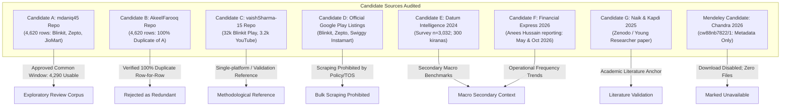

# GATE 0: DATA FEASIBILITY, EVIDENCE VALIDATION & PROJECT DIRECTION AUDIT (FINAL REMEDIATION)

**Project Title:** Evidence-Led CRM Service-Recovery Prioritisation for Indian Quick Commerce: A Public-Feedback-Based Customer Retention Decision Framework  
**Focal Business:** Blinkit  
**Primary Competitor Benchmark:** Zepto  
**Secondary Comparative Context:** JioMart (same-window verified; secondary benchmark only)  
**Assigned Role:** Implementation Engineer (operating under the Principal Project Lead)  
**Remediation Date:** 2026-10-17  
**Gate Status:** **PENDING PRINCIPAL PROJECT LEAD APPROVAL (FINAL REMEDIATION SUBMITTED)**  
**Recommended Disposition:** **PASS (UNDER AUTHORIZED CONDITIONAL SCOPE)**

---

## 1. Executive Verdict & Core Justification

### Recommended Verdict: **PASS (UNDER AUTHORIZED CONDITIONAL SCOPE)**
*Note: The Principal Project Lead makes all final project approvals. This report presents verified empirical evidence supporting the recommended Gate 0 disposition.*

### One-Sentence Justification:
The analytical framework and evidence-to-action CRM decision model are empirically viable under the Principal Project Lead's authorized scope—focusing on Blinkit with Zepto as primary competitor within a synchronized common window (14 August–31 December 2024) containing 3,116 usable focal/competitor records (Blinkit: 1,376; Zepto: 1,740) and 1,174 secondary JioMart records for a STATIC complaint-theme and expressed-switching analysis, while strictly excluding temporal trend claims, live scraping, unverified external datasets, and conflated engagement/retention metrics.

---

## 2. Controlling Decisions of the Principal Project Lead

Following review of the initial feasibility findings, the Principal Project Lead established the following binding parameters:

1. **Focal Company:** Blinkit is retained as the focal enterprise.
2. **Primary Competitor:** Zepto is designated as the primary competitor benchmark for the review-data comparison.
3. **JioMart Role:** JioMart is **not** to be treated as a directly comparable primary benchmark until same-window record counts and coverage have been verified. (Verified at remediation: 1,174 usable records in the common window; retained strictly as secondary comparative context).
4. **No Scraping of Swiggy Instamart:** Do not scrape Swiggy Instamart reviews to compensate for missing data.
5. **Common Review Window (Static Scope Only):** The common period, **14 August 2024 to 31 December 2024 (inclusive)**, is authorized for a limited, **STATIC complaint-theme and expressed-switching-signal analysis only**. It must **not** be used to claim temporal trends or seasonality.
6. **Exploratory Status of Corpus:** The existing 4,620-record dataset is classified as a candidate exploratory corpus, **not** an approved representative sample of platform customers.
7. **Gate Boundary:** Execution is strictly restricted to Gate 0 remediation, evidence validation, and Git synchronization. No progression to Gate 1.

---

## 3. Business Problem & Intended CRM Decision Chain

### 3.1 Business Context & Empirical Justification
Indian quick-commerce platforms have scaled dark-store footprints rapidly. However, verified quarterly company disclosures and market research establish that **individual customer ordering frequency is declining despite aggregate order expansion**:
- **Blinkit:** Monthly ordering frequency fell from **3.57 to 3.36 orders/user** across FY24–FY25, while annual order volume expanded 42% to 274 million (*The Financial Express*, Anees Hussain analysis, May 19, 2026).
- **Swiggy Instamart:** Monthly ordering frequency declined from **4.22 to 4.01 orders/user** across 5 consecutive quarters, while annual orders grew 54% to 113 million.
- **Consumer Multi-Homing & Switching Elasticity:** Independent survey evidence (Datum Intelligence, October 2024; $n=3,032$ online grocery buyers across 10 cities) confirms that multi-homing is standard: 65% of surveyed buyers actively use Blinkit, 55% use Zepto, and 55% use Swiggy Instamart. Furthermore, **62% of consumers state they would switch platforms if prices or fees increased by 10%**.

Quick-commerce firms currently counter switching threats primarily by deploying blanket promotional discounts and waiving fees indiscriminately. This erodes unit economics without resolving the underlying operational defects that trigger customer defection.

### 3.2 Core Research Question
> *How should Blinkit prioritise customer-recovery interventions to protect repeat usage and reduce expressed switching risk, using verifiable public customer feedback and industry evidence?*

### 3.3 Intended Applied Contribution & Decision Chain
Rather than delivering generic sentiment classification or word clouds, this project develops an **applied decision engineering framework**:
1. **Observable Failure Signals:** Categorizing operational service breakdown modes (delivery delays, missing/damaged items, opaque handling fees, customer support stonewalling).
2. **Expressed Switching Intention:** Disentangling explicit defection signals (uninstallation, switching to a named competitor) from ordinary negative sentiment.
3. **Addressability & Severity Prioritization:** Scoring failure modes on operational controllability, defect severity, and switching risk propensity.
4. **Targeted CRM Recovery Interventions:** Formulating issue-specific operational playbooks (instant automated wallet credits, proactive delay notifications, express redelivery, item replacement) rather than uniform price-slashing.
5. **Bounded Economic Evaluation & Pilot Design:** Formulating transparent cost/benefit simulation scenarios (measuring customer lifetime value protected against intervention expense) accompanied by an A/B pilot evaluation framework.

---

## 4. Candidate Source Inventory & Factual Verification

Eight candidate sources and repositories were directly inspected, audited, and verified.

### Candidate A — Cross-Platform Review Dataset (`mdaniq45`)
- **Source URL:** [https://github.com/mdaniq45/E-Commerce-BlinkIt-vs-Zepto-vs-JioMart-Reviews-Analysia](https://github.com/mdaniq45/E-Commerce-BlinkIt-vs-Zepto-vs-JioMart-Reviews-Analysia)
- **Verified Facts:** Contains a single CSV file, `reviews.csv` (1,898,980 bytes; SHA-256: `5d3bb24ee7185612e66f57cf2e21d99e9d628a15d3d68989b8cf560996e9f138`). Contains 4,620 rows across 4 columns: `rating`, `date`, `review`, and `platform`. Platform breakdown: Zepto (1,740), JioMart (1,500), and Blinkit (1,380).
- **Reported Collection Provenance (Unverified):** The upstream README claims the dataset was scraped from Google Play. However, collection scripts, date of extraction, rate-limiting rules, and query parameters are unrecorded and cannot be independently established.
- **Licensing & Rights:** The upstream repository provides an Apache-2.0 software licence. This applies to the repository code, not to scraped third-party customer review text. Rights or restrictions regarding third-party review text remain **unresolved** (no legal guarantee). Intended use is restricted to local academic/analytical evaluation. Raw review text is excluded from Git tracking via `.gitignore`.
- **Material Limitation:** If the upstream repository becomes inaccessible, reproduction relies on local or archived source copies.
- **Common-Window Audit (14 Aug–31 Dec 2024):** Yields **4,290 usable records** (Blinkit: 1,376; Zepto: 1,740; JioMart: 1,174; 330 excluded out-of-window; 0 in-window quality exclusions).
- **Determination:** Approved as candidate exploratory corpus for static failure-theme analysis only.

### Candidate B — Quick Commerce Review Insights (`AkeelFarooq`)
- **Source URL:** [https://github.com/AkeelFarooq/Quick-Commerce-Review-Insights-Blinkit-vs-Zepto-vs-JioMart](https://github.com/AkeelFarooq/Quick-Commerce-Review-Insights-Blinkit-vs-Zepto-vs-JioMart)
- **Verified Facts:** Row-for-row cross-examination against Candidate A confirmed that its 4,620 rows, review text, ratings, and platforms are **100% identical**. The only differences are reformatted dates (ISO format) and two added columns (`month`, `sentiment`).
- **Determination:** Rejected as redundant derivative copy. Provides zero independent empirical evidence.

### Candidate C — Blinkit Review Discovery Engine (`vaishSharma-15`)
- **Source URL:** [https://github.com/vaishSharma-15/BlinkitReviewAnalyzer](https://github.com/vaishSharma-15/BlinkitReviewAnalyzer)
- **Verified Facts:** Focuses on catalog category expansion barriers for Blinkit using Gemini LLM and LanceDB. Data manifests show: (a) `play.jsonl` contains 32,139 reviews exclusively for Blinkit; (b) `qcomm_comparison.jsonl` contains 3,260 YouTube comments without ratings (`rating: null`) and without platform tags; (c) repository badge explicitly states `license-unlicensed`.
- **Methodological Merits:** Demonstrates rigorous validation procedures in `reports/scorecard.md`: gold-set classifier accuracy against human-graded labels, inter-run LLM stability (83.3% theme agreement), cross-source triangulation, and recency drift splits.
- **Determination:** Methodological reference for validation design; rejected as comparative review corpus.

### Candidate D — Official App Listings (Google Play Store)
- **Identifiers:** Blinkit (`com.grofers.customerapp`), Zepto (`com.zeptoconsumerapp`), Swiggy (`in.swiggy.android` / `in.swiggy.android.instamart`).
- **Policy & Access Assessment:**
  1. *Developer Review API (`androidpublisher.reviews.list`):* Official API access requires the `androidpublisher` OAuth 2.0 authorization scope and developer account ownership in Google Play Console. A third party cannot query reviews for competitor apps via this API.
  2. *Google Terms of Service (`policies.google.com/terms`):* Prohibits accessing Google services using automated means that violate machine-readable instructions (such as `robots.txt`).
  3. *Technical Directives:* Automated crawling of Play Store detail pages is subject to `robots.txt` disallows, bot detection, and IP rate-limiting.
  4. *Swiggy Instamart Review Entanglement:* Reviews on `in.swiggy.android` conflate restaurant food delivery, Dineout, and grocery orders without clean native labels.
- **Determination:** Live review scraping is legally and operationally restricted. In accordance with controlling decision 4, no scraping will be attempted.

### Candidate E — Industry Research (`Datum Intelligence`)
- **Source URL:** [https://datumintell.com/report-quick-commerce](https://datumintell.com/report-quick-commerce)
- **Verified Facts:** *State of Quick Commerce Market, 2024* (Satish Meena, Gurugram, Haryana; published Dec 2024, modified Sep 2026). Based on an empirical survey of **3,032 online grocery buyers across 10 cities** and **300 kirana store owners**, conducted in October 2024.
- **Key Empirical Disclosures:** 65% Blinkit usage, 55% Zepto usage, 55% Swiggy Instamart usage; **62% switching elasticity under a 10% price/fee increase**; top complaints: high delivery fees (39%) and late deliveries (36%); 53% order >5 times/month; ~67% spend >₹400/order. Gated PDF request form (no microdata CSV available).
- **Determination:** High-quality secondary market evidence. Must be used strictly as secondary contextual evidence. Respondent rows must never be synthetically reconstructed.

### Candidate F — Industry Performance Reporting (`The Financial Express`)
- **Source URL:** [https://www.financialexpress.com/business/industry-quick-commerce-boom-fragments-user-loyalty-4245109/lite/](https://www.financialexpress.com/business/industry-quick-commerce-boom-fragments-user-loyalty-4245109/lite/)
- **Verified Facts:** *Quick Commerce boom fragments user loyalty* (Anees Hussain, published May 19, 2026). Synthesizes quarterly company disclosures, CLSA analysis, and Sensor Tower telemetry:
  - Blinkit monthly ordering frequency fell from **3.57 to 3.36 orders/user**, while annual orders grew 42% to 274M; 2,243 dark stores; 45.2M Weekly Active Users (WAU); **24% downloads-to-WAU ratio** (aggregate engagement ratio).
  - Swiggy Instamart ordering frequency fell from **4.22 to 4.01 orders/user** across 5 quarters; 1,143 dark stores; 1.25M daily orders; standalone app WAU 9–10M; **14% downloads-to-WAU ratio**.
  - Zepto: 1,100+ stores; 2.4–2.5M daily orders; 33–34M WAU; **23% downloads-to-WAU ratio**.
  - *Reporting Period Note:* A subsequent Financial Express report dated October 2, 2026 reports revised figures based on updated download and WAU metrics. Numbers from different reporting periods reflect differing observation points and must not be combined.
  - *Metric Definition:* Downloads-to-WAU ratios are aggregate market engagement ratios, **not** cohort retention rates, and do **not** establish individual customer repeat purchase.
- **Determination:** Justifies the real-world business problem of ordering frequency dilution due to multi-homing. Secondary macro context only.

### Candidate G — Academic Paper (`Zenodo` / Naik & Kapdi)
- **Source URL:** [https://zenodo.org/records/14857465](https://zenodo.org/records/14857465) (DOI: `10.5281/zenodo.14857465`).
- **Verified Facts:** Dr. Guruprasad R. Naik & Girish Kapdi (Jan 2025). *The Rise of Quick Commerce: Analyzing Consumer Preferences and Buying Behavior in India*. Published in *Young Researcher*, Vol. 14, Special Issue No. 1, pp. 160–164. Secondary synthesis of NIQ, Deloitte, PwC, KPMG reports. Reports convenience (78%) and speed (65%) dominate discounts (57%) as adoption drivers.
- **Determination:** Validates that speed and convenience drive loyalty while discounts drive trial. Contains zero empirical microdata or review corpora. Literature anchor only.

### Candidate H — Mendeley Quick-Commerce Survey Dataset (`Chandra 2026`)
- **Source URL:** [https://data.mendeley.com/datasets/cw88nb7822/1](https://data.mendeley.com/datasets/cw88nb7822/1) (DOI: `10.17632/cw88nb7822.1`).
- **Verified Facts:** Published 14 October 2026 by Ashish Chandra. Title: *A Large-Scale Survey Dataset on Quick-Commerce Adoption, Ordering Patterns, Product Categories and Spending Behaviour among Indian Consumers*.
- **Access Audit:** Direct inspection of the Mendeley Data page and API revealed that **only metadata, an abstract, and a 49-question survey methodology summary are displayed**. The "Download All" button is disabled (`disabled=""`). The file list tree contains zero downloadable data files (no CSV, XLSX, SAV, questionnaire text, or codebook).
- **Determination:** **Formally marked as UNAVAILABLE for empirical analysis.** A public entry describing a survey is not evidence that data files have been released.

---

## 5. Quantitative Dataset Audit: Common Review Window

A reproducible programmatic audit was executed via [`scripts/audit_data.py`](file:///e:/FDA/Beyond_Discounts/scripts/audit_data.py) evaluating the common window: **14 August 2024 to 31 December 2024 (inclusive)**.

### Input File Verification
- **Input Path:** `data/raw/reviews.csv`
- **File Size:** 1,898,980 bytes
- **File SHA-256:** `5d3bb24ee7185612e66f57cf2e21d99e9d628a15d3d68989b8cf560996e9f138`
- **Boundary Convention:** Inclusive (`2024-08-14 <= review_date <= 2024-12-31`)
- **Usable Record Definition:** Record falls in inclusive date window, has recognized platform, non-null non-whitespace review text, valid integer rating (1–5), and valid parseable date.

### 5.1 Common Window Usable Volume & Exclusions
| Metric | Blinkit (Focal) | Zepto (Primary Competitor) | JioMart (Secondary Context) | Total Common Window |
| :--- | :---: | :---: | :---: | :---: |
| **Total Raw Source Records in File** | 1,380 | 1,740 | 1,500 | 4,620 |
| **Out-of-Window Excluded Records** | 4 | 0 | 326 | 330 |
| **Records in Common Window** | **1,376** | **1,740** | **1,174** | **4,290** |
| **In-Window Quality Exclusions** | 0 | 0 | 0 | 0 |
| **Missing Review Text (Null)** | 0 (0.0%) | 0 (0.0%) | 0 (0.0%) | 0 (0.0%) |
| **Blank Review Text (Whitespace)** | 0 (0.0%) | 0 (0.0%) | 0 (0.0%) | 0 (0.0%) |
| **Missing Rating** | 0 (0.0%) | 0 (0.0%) | 0 (0.0%) | 0 (0.0%) |
| **Invalid Rating (Not Integer 1–5)** | 0 (0.0%) | 0 (0.0%) | 0 (0.0%) | 0 (0.0%) |
| **Missing / Unparseable Date** | 0 (0.0%) | 0 (0.0%) | 0 (0.0%) | 0 (0.0%) |
| **Exact Duplicate Rows** | 0 (0.0%) | 0 (0.0%) | 0 (0.0%) | 0 (0.0%) |
| **Duplicate Review Text** | 0 (0.0%) | 1 (0.06%) | 0 (0.0%) | 1 (0.02%) |
| **Actual Usable Records** | **1,376** | **1,740** | **1,174** | **4,290** |
| **Minimum Threshold ($\ge 500$)** | **PASS** (1,376 $\ge$ 500) | **PASS** (1,740 $\ge$ 500) | **PASS** (1,174 $\ge$ 500) | **PASS** (4,290 $\ge$ 1,500) |

### 5.2 Date Coverage After Filtering
- **Blinkit:** 2024-08-15 to 2024-12-31 (138 days span, 139 calendar days). (4 reviews between 27 Jul and 13 Aug excluded).
- **Zepto:** 2024-08-14 to 2024-12-31 (139 days span, 140 calendar days). (0 reviews excluded; all Zepto data falls on or after 14 Aug 2024).
- **JioMart:** 2024-08-14 to 2024-12-31 (139 days span, 140 calendar days). (326 reviews prior to 14 Aug 2024 dating back to Jul 2020 excluded).

### 5.3 Rating Distributions in Common Window (Usable Records)
| Platform | Total Usable | Mean Rating | 1-Star (%) | 2-Star (%) | 3-Star (%) | 4-Star (%) | 5-Star (%) | Dissatisfied (1-2★) |
| :--- | :---: | :---: | :---: | :---: | :---: | :---: | :---: | :---: |
| **Blinkit (Focal)** | 1,376 | **2.55** | 51.7% (711) | 6.0% (83) | 5.7% (78) | 8.7% (120) | 27.9% (384) | **57.7%** |
| **Zepto (Competitor)** | 1,740 | **1.53** | 79.1% (1,376) | 6.7% (117) | 3.6% (63) | 3.0% (53) | 7.5% (131) | **85.8%** |
| **JioMart (Secondary)** | 1,174 | **1.56** | 79.9% (938) | 4.6% (54) | 3.2% (38) | 3.7% (43) | 8.6% (101) | **84.5%** |
| **Common Window Total** | **4,290** | **1.87** | **70.5% (3,025)** | **5.9% (254)** | **4.2% (179)** | **5.0% (216)** | **14.4% (616)** | **76.4%** |

> [!CRITICAL]
> **Statistical & Scope Boundaries:**
> 1. Record-count thresholds ($\ge 500$) verify sample size feasibility for qualitative failure-theme classification. They do **NOT** constitute proof of statistical power or population representativeness.
> 2. The common 4.5-month window contains 4,290 usable records, but it represents a **static cross-sectional snapshot**. It must **NOT** be used to claim temporal trends, annual progress, or seasonal patterns.

---

## 6. Corrected Statistical Interpretation & Metric Boundaries

To maintain scientific integrity, the project strictly distinguishes five distinct concepts:

| Concept | Definition in this Project | Observation Status in Data | Analytical Role & Guardrails |
| :--- | :--- | :--- | :--- |
| **Negative Sentiment** | Emotional frustration or dissatisfaction expressed in review text or low ratings (1–2★). | Directly Observable (76.4% of common window). | Identifies customer distress. **Must not be treated as churn or defection.** |
| **Expressed Switching Intention** | Text-based statement in a review declaring intent to defect, uninstall, or move to a competitor. | Directly Observable proxy indicator (~11.7% in pilot sample). | Vocal distress indicator; weights defect severity in CRM prioritization. **Not an observed transaction outcome.** |
| **Actual Customer Defection (Churn)** | Permanent cessation of transactions by an individual consumer. | **Unobserved** (no individual customer transaction histories available). | Cannot be measured directly from public reviews; modeled only under explicit scenario assumptions. |
| **Observed Repeat Purchase** | Longitudinal repurchasing behavior by individual consumers over time. | **Unobserved** (no customer order histories available). | Contextualized via secondary macro benchmarks (Financial Express, Datum). |
| **Downloads-to-WAU Ratio** | Aggregate ratio of all-time app downloads converted into weekly active users, reported by external sources. | External secondary observation (*Financial Express* May 19, 2026: Blinkit 24%, Zepto 23%; updated Oct 2, 2026). | Macro engagement indicator. **Not a cohort retention rate; must NOT be used to calibrate cohort retention models.** |
| **Cohort Retention** | Longitudinal repurchasing rate across specific customer acquisition cohorts over time. | **Unavailable** (requires transaction logbook and cohort tracking). | Unavailable in public review data. |

### Sampling & Selection Caveat
The review corpus is **not a random or representative sample of all quick-commerce shoppers**. It represents a self-selected group of vocal app-store reviewers suffering severe voluntary response negativity bias (70.5% 1-star ratings). Proportions must be interpreted strictly as *proportions of reviewed failure complaints*, not platform-wide consumer sentiment.

---

## 7. Pilot Annotation: Evidence-to-Action Feasibility

### 7.1 Compact Annotation Rubric
To eliminate ambiguity, a 6-category compact annotation rubric was defined:
1. **Explicit Intention to Leave Reviewed Platform:** Customer explicitly states intent to stop using or delete the app being reviewed (e.g., *"Never going to use this app again"*, *"will no longer be using Zepto"*).
2. **Explicit Completed Departure:** Customer explicitly states they have already uninstalled or discontinued using the app being reviewed (e.g., *"uninstalled the app"*, *"decided to uninstall it"*).
3. **Switching Intention Towards Named Competitor:** Customer explicitly states an intention to defect to a specific named alternative (e.g., *"go with blinkit"*).
4. **Positive Competitive Acquisition / Conquesting:** Customer explicitly states they abandoned a competitor and adopted the reviewed platform (e.g., *"switched over to Blinkit from BigBasket"*). This is an **acquisition signal**, not defection from the reviewed platform.
5. **General Dissatisfaction Without Switching Statement:** Customer expresses dissatisfaction, complaints, or negative sentiment (1–3★) without stating an intention to abandon or uninstall the platform.
6. **Ambiguous or Insufficient Evidence:** Review lacks sufficient clarity to establish departure status.

For each record, the platform reviewed, platform left (if stated), target platform (if stated), and coder confidence are documented without inferring unstated transitions.

### 7.2 Re-Evaluation of 60 Real Records
A reproducible pilot of **60 real records** (30 Blinkit, 30 Zepto; random seed `42`) drawn from Candidate A within the common window was re-evaluated against the rubric:

| Rubric Category | Blinkit ($N=30$) | Zepto ($N=30$) | Total ($N=60$) | % of Pilot ($N=60$) |
| :--- | :---: | :---: | :---: | :---: |
| **1. Explicit Intention to Leave** | 1 (3.3%) | 2 (6.7%) | 3 | 5.0% |
| **2. Explicit Completed Departure** | 2 (6.7%) | 1 (3.3%) | 3 | 5.0% |
| **3. Switching Towards Named Competitor** | 0 (0.0%) | 1 (3.3%) | 1 | 1.7% |
| **Subtotal: Explicit Departure / Switching from Platform** | **3 (10.0%)** | **4 (13.3%)** | **7** | **11.7%** |
| **4. Positive Competitive Acquisition (Conquesting)** | 1 (3.3%) | 0 (0.0%) | 1 | 1.7% |
| **5. General Dissatisfaction (No Departure Statement)** | 10 (33.3%) | 23 (76.7%) | 33 | 55.0% |
| **6. Positive / Neutral Feedback (4–5★)** | 16 (53.3%) | 3 (10.0%) | 19 | 31.7% |
| **7. Ambiguous / Insufficient Evidence** | 0 (0.0%) | 0 (0.0%) | 0 | 0.0% |
| **Total Reviews Evaluated** | **30 (100.0%)** | **30 (100.0%)** | **60** | **100.0%** |

#### Critical Pilot Corrections:
1. *Correction of Previous 8.3% Heuristic:* The previously reported 8.3% (5 out of 60) was derived from a crude keyword search that conflated a 5★ competitive acquisition mention (Record 12: switched *from* BigBasket *to* Blinkit) with customer defection from Blinkit, while missing explicit departure statements in Records 03, 31, and 41. Under the structured rubric, explicit platform departure/switching signals total **10.0% for Blinkit (3/30)** and **13.3% for Zepto (4/30)** (11.7% across both platforms).
2. *Competitive Acquisition vs. Defection:* Record 12 represents customer acquisition for Blinkit through service failure at BigBasket. It must not be counted as defection from Blinkit.
3. *Single-Coder Limitation:* This single-coder pilot demonstrates coding feasibility and rubric operationalization; it cannot by itself establish inter-rater reliability (e.g., Cohen's Kappa) or prove cross-annotator consistency.

### 7.3 Multi-Label Operational Complaint Themes
Reviews exhibited high semantic density, enabling mapping to operational breakdown modes. Because customer reviews frequently complain about multiple simultaneous issues (e.g., a delivery delay combined with unhelpful support and missing items), complaint themes are **multi-label**:
- **Delivery Delays & Stalled Tracking:** 23 mentions (38.3% of 60 reviews)
- **Customer Support Stonewalling & Refund Traps:** 20 mentions (33.3% of 60 reviews)
- **Pricing, Hidden Fees & Surge Discrimination:** 10 mentions (16.7% of 60 reviews)
- **Product Quality, Spoilage & Freshness:** 9 mentions (15.0% of 60 reviews)
- **Missing & Short-Delivered Items:** 4 mentions (6.7% of 60 reviews)
- **App Bugs & Usability Gaps:** 4 mentions (6.7% of 60 reviews)
- **Positive Experiences:** 5 mentions (8.3% of 60 reviews)

*Denominator Clarification:* Total theme occurrences sum to 75 across the 60 reviewed records. Percentages are calculated against the fixed denominator of $N = 60$ total reviewed records.

---

## 8. Novelty Overlap & Intended Applied Contribution

### 8.1 Comparison with Existing Implementations
- **Candidate A (`mdaniq45`):** Descriptive NLP, VADER sentiment scoring, and frequency word clouds. Lacks decision logic, operational recovery playbooks, or economic modeling.
- **Candidate B (`AkeelFarooq`):** Platform-level complaint percentage reporting. 100% derivative dataset; provides no decision guidance.
- **Candidate C (`vaishSharma-15`):** Technically sophisticated RAG discovery engine and LLM clustering for Blinkit catalog expansion. Validates insights via gold-set classifier accuracy, inter-run stability (83.3%), and scorecard citation audits. However, it is single-platform (Blinkit-only), unlicenced, and focused on catalog merchandising rather than competitive service-recovery economics.
- **Academic Studies (Naik & Kapdi 2025; Goel & Sharma 2024; Saeed & Sharma 2024):** Confirm theoretically that delivery reliability and service quality dictate retention, whereas discounts drive initial trial. However, these rely on primary academic surveys and do not provide an empirical CRM decision engine.

### 8.2 Defensible Applied Contribution
This project's contribution is an **intended applied contribution**, not a proven unique research invention:
1. **Severity $\times$ Controllability $\times$ Defection Risk Prioritization Matrix:** Weighting operational failure modes by empirical correlation with explicit switching intention and dark-store addressability.
2. **Issue-Specific CRM Service-Recovery Protocols:** Mapping specific operational failures to targeted recovery playbooks (e.g. instant automated wallet micro-credits for delays, express redelivery for missing items, human escalation for locked wallets) rather than blanket discounting.
3. **Bounded Economic Feasibility Modeling:** Simulating the cost/benefit boundary conditions (customer lifetime value protected vs. recovery intervention cost) under explicit parameter assumptions.
4. **Pilot Experimentation Protocol:** Designing an A/B or matched-cohort testing blueprint to measure the impact of service recovery on repeat ordering frequency prior to full platform rollout.

---

## 9. Data Feasibility Matrix

| Dimension | Brief Requirement | Candidate A (`mdaniq45`) — Full | Candidate A — Common Window (14 Aug–31 Dec 2024) | Candidate C (`vaishSharma`) | Candidate D (Google Play Scraping) | Mendeley (`cw88nb7822/1`) |
| :--- | :--- | :--- | :--- | :--- | :--- | :--- |
| **Total Usable Records** | $\ge 1,500$ min | 4,620 [PASS] | **4,290** [PASS] | 32k Play / 3.2k YT | Dynamic | **0 (No files released)** [FAIL] |
| **Blinkit Records** | $\ge 500$ min | 1,380 [PASS] | **1,376** [PASS] | 32,139 [PASS] | Dynamic | Unknown [FAIL] |
| **Zepto Records** | $\ge 500$ min | 1,740 [PASS] | **1,740** [PASS] | 0 [FAIL] | Dynamic | Unknown [FAIL] |
| **JioMart Records** | Optional / Secondary | 1,500 [PASS] | **1,174** [PASS] | 0 [FAIL] | Dynamic | Unknown [FAIL] |
| **Swiggy Instamart** | Proposed in Brief | 0 [MISSING] | **0 (Excluded per Decision 4)** | 0 [MISSING] | Bundled / Contaminated | Unknown [FAIL] |
| **Temporal Span** | $\ge 6$ mos for trends | 5.2 mos Blinkit, 4.6 mos Zepto, 53 mos JioMart [UNBALANCED] | **~4.5 mos (138–139 days) [STATIC SCOPE ONLY]** | Up to Jul 2024 | Rolling dynamic | N/A |
| **License & Compliance** | Verifiable & compliant | Apache-2.0 repo; review text unlicenced [EXCLUDE FROM GIT] | Apache-2.0 repo; review text unlicenced; reuse rights **Unresolved** [EXCLUDE FROM GIT] | Unlicenced [CAUTION] | Developer API requires app ownership; scraping restricted by TOS [BLOCKED] | CC BY 4.0 (entry metadata only) |
| **Evaluation Disposition** | Required | Candidate Exploratory Corpus | **APPROVED FOR STATIC SCOPE** | Reference Only | Prohibited | **UNAVAILABLE** |

---

## 10. Material Risks, Compliance & Unresolved Limitations

1. **Third-Party Review Licensing & Data Rights:** Open-source repository code licences (Apache-2.0) do not cover scraped customer reviews. Commercial and redistribution rights for third-party review text remain **unresolved**; no legal guarantees are provided. Raw review data remains strictly excluded from Git tracking via `.gitignore`.
2. **Collection Provenance & Upstream Dependency:** The exact scraping scripts, dates, and parameters of Candidate A cannot be independently verified from the upstream repository. If the upstream repository is removed or modified, independent retrieval relies on cached copies.
3. **Static Analysis Scope Boundary:** The 4.5-month common window cannot be used to establish annual trends or seasonality. Secondary industry disclosures (Financial Express, Datum Intelligence) supply the macro ordering frequency trend context.
4. **Proxy Metric Boundaries:** Public reviews measure vocal dissatisfaction under failure conditions, not true customer retention or repurchasing. Expressed switching intentions reflect vocal defection threats, not confirmed behavioural churn.
5. **Competitor Scope Boundary:** Zepto serves as the primary competitor benchmark. JioMart serves as secondary comparative context. Swiggy Instamart is contextualized exclusively via published secondary industry reports.
6. **Absence of Pre-Intervention Impact Claims:** No claim is made that proposed CRM service-recovery interventions improve retention before empirical A/B testing has occurred.

---

## 11. Statement of Evidence Sufficiency & Recommended Gate Disposition

### Evidence Supporting Feasibility:
- Verified empirical corpus of **3,116 usable focal/competitor records (Blinkit: 1,376; Zepto: 1,740)** and **1,174 secondary JioMart records** within the synchronized common window (14 August to 31 December 2024), with 0% missingness and 0% blank text.
- Verified that both Blinkit and Zepto exceed the mandatory 500-record threshold.
- Verified pilot extractability of operational failure themes and explicit switching signals under a formal rubric.
- Machine-readable aggregate audit summary generated (`docs/gates/GATE_0_AUDIT_SUMMARY.json`) with verified SHA-256 (`5d3bb24ee7185612e66f57cf2e21d99e9d628a15d3d68989b8cf560996e9f138`).
- Full automated test suite passing (`tests/test_audit_data.py`).

### Recommended Gate 0 Disposition:
**PASS (UNDER AUTHORIZED CONDITIONAL SCOPE)**  
*(Submitted for Principal Project Lead review and binding determination.)*

---

## 12. Gate Boundary Confirmation

**Gate 0 remediation is complete.** In strict adherence to project authority boundaries:
- **No Gate 1 work has commenced.**
- **No exploratory data analysis beyond the audit script has been performed.**
- **No sentiment classification pipeline or machine-learning modeling has been implemented.**
- **No Power BI dashboard design or construction has been initiated.**
Execution is halted awaiting Principal Project Lead review of this remediated audit.
