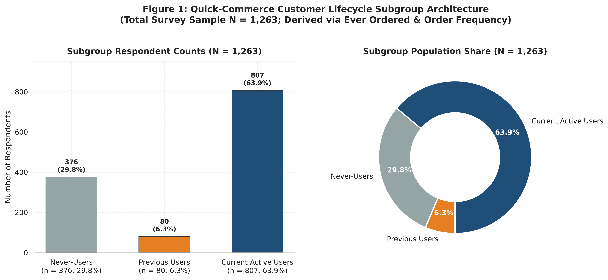
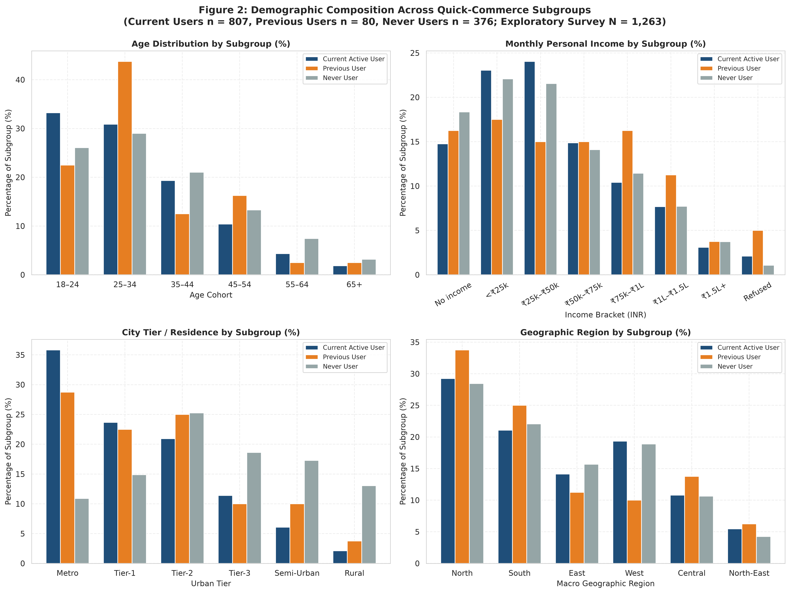
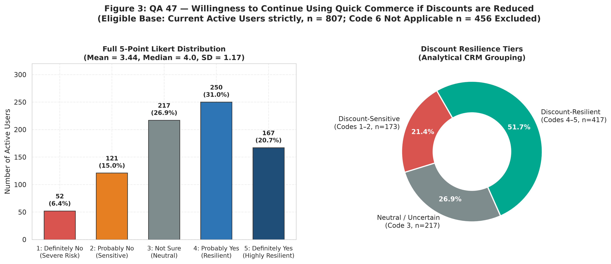
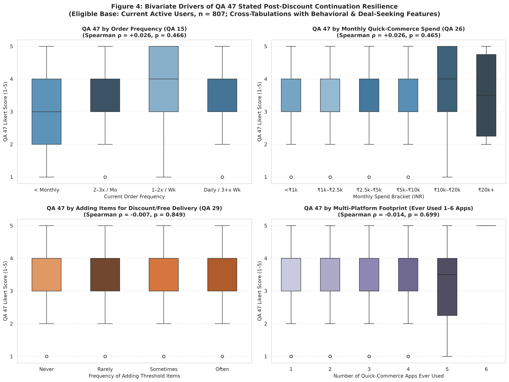
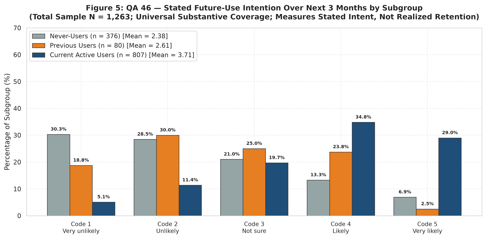
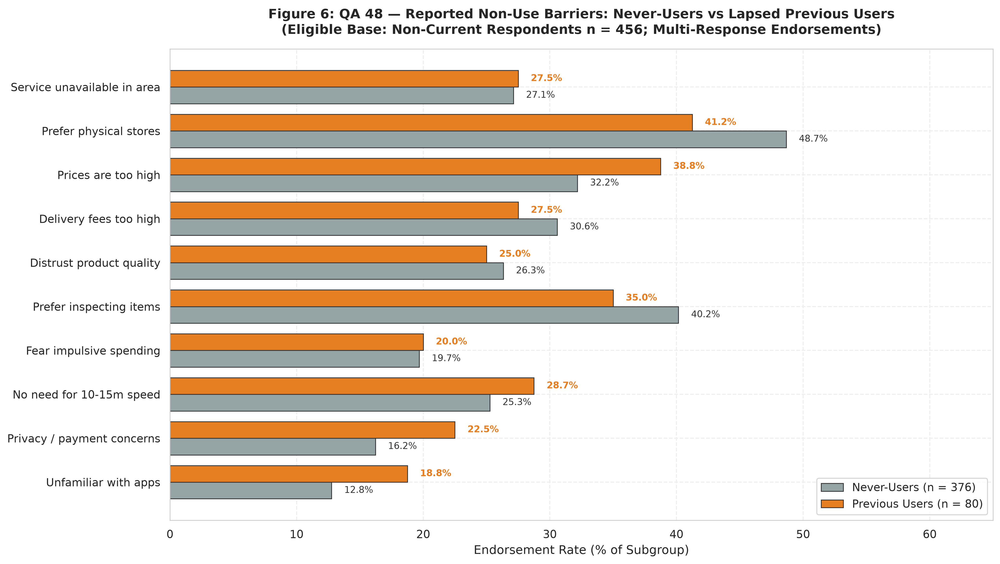
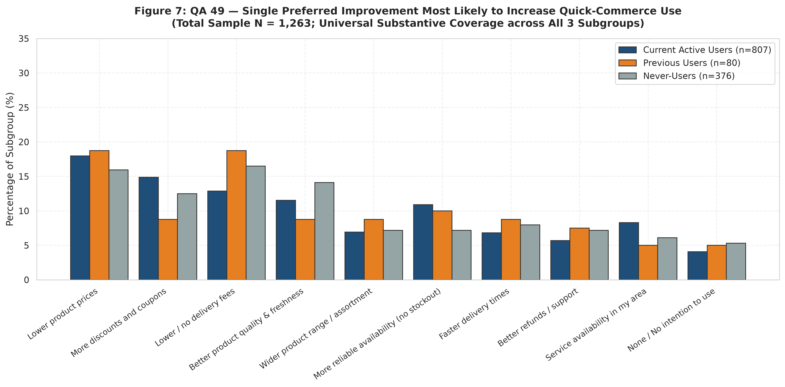
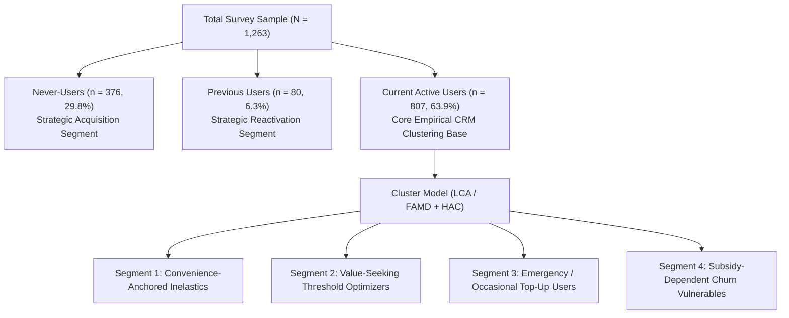
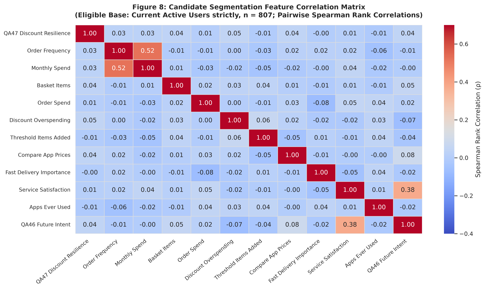

# Gate 1A: Comprehensive Exploratory Data Analysis Report

**Canonical Project Title:** Beyond Discounts: Customer Segmentation and Retention Strategy for Indian Quick Commerce  
**Controlling Dataset:** `data/raw/survey/Data.xlsx` (Worksheet `Data`, 1,263 rows × 130 columns)  
**Primary Instrument:** `data/raw/survey/Questionairre.docx` & `data/raw/survey/Code Book.docx` (Chandra, Mendeley Data, DOI: `10.17632/cw88nb7822.1`)  
**Phase:** Gate 1A — Exploratory Data Analysis & Customer Segmentation Feasibility  
**Assigned Role:** Implementation Worker (under the Principal Project Lead)  
**Date:** 2026-10-17  
**Status:** **SUBMITTED FOR PRINCIPAL PROJECT LEAD REVIEW**  

---

## 1. Executive Summary & Canonical Project Framing

### Approved Canonical Framing
- **Project Title:** *Beyond Discounts: Customer Segmentation and Retention Strategy for Indian Quick Commerce*
- **Research Question:** *How do quick-commerce consumers differ in their discount sensitivity, usage behaviour, and stated future-use intentions, and what adoption, reactivation, or retention actions are supported by these differences?*
- **Investigated Problem:** Quick-commerce consumers differ substantively in the weight they place on promotional pricing, delivery velocity, everyday convenience, order value, and service reliability. A uniform retention strategy cannot address this heterogeneity.
- **Proposed Business Value:** Developing data-grounded customer segmentation frameworks to guide targeted acquisition (non-users), reactivation (lapsed users), and non-discount value-proposition retention (active users).
- **Framing Correction Lock:** The previous exploratory framing designating Blinkit as a single focal firm has been formally superseded. The empirical survey captures industry-wide consumer behavior across the Indian quick-commerce sector rather than firm-specific customer satisfaction or brand-level retention outcomes.

### Key Analytical Findings at Gate 1A
1. **Verified Population Architecture ($N = 1,263$):**  
   The sample is cleanly partitioned into three mutually exclusive subgroups:
   - **Never-Users:** $n = 376$ ($29.77\%$), who have never placed a quick-commerce order.
   - **Previous Users:** $n = 80$ ($6.33\%$), who have placed orders historically but currently report zero orders (lapsed cohort).
   - **Current Active Users:** $n = 807$ ($63.89\%$), actively ordering across varied frequencies.
2. **Post-Discount Continuation Resilience Baseline (QA 47, $n = 807$):**  
   Among current active users, stated willingness to continue ordering if discounts and coupons are reduced yields a mean score of $3.45 \pm 1.16$ (Median $4.0$, IQR $1.0$).
   - **Discount-Sensitive Tier (Codes 1–2):** $n = 173$ ($21.44\%$), representing severe retention risk under promotional pullback.
   - **Neutral / Uncertain Tier (Code 3):** $n = 217$ ($26.89\%$), vulnerable fence-sitters sensitive to delivery fees and threshold mechanics.
   - **Discount-Resilient Tier (Codes 4–5):** $n = 417$ ($51.67\%$), whose quick-commerce habits are anchored in convenience, speed, and emergency utility.
   - *(Mandatory Routing Semantic: Code 6 among the 456 non-current users is strictly a questionnaire routing skip code; it must never be coded as churn or negative sentiment).*
3. **Decoupling of Discount Resilience from Volume/Spend Heuristics:**  
   Bivariate rank correlations between QA 47 and conventional behavioral metrics are near-zero and statistically non-significant:
   - Order Frequency (QA 15): Spearman $\rho = +0.026$ ($p = 0.466$).
   - Monthly Spend Tier (QA 26): Spearman $\rho = +0.026$ ($p = 0.465$).
   - Multi-Platform Footprint (QA 12): Spearman $\rho = -0.014$ ($p = 0.699$).  
   *Analytical Implication:* High order frequency or high spend does **not** automatically confer discount resilience. Segmenting customers purely along 1D RFM thresholds would fail to detect discount-dependent high-spenders. Multi-dimensional segmentation is empirically necessary.
4. **Adoption vs Churn Friction (QA 48, $n = 456$):**  
   Never-users and lapsed users cite nearly identical barrier rankings: physical store preference ($48.67\%$ vs $41.25\%$), preference for physical product inspection ($40.16\%$ vs $35.00\%$), and high perceived pricing ($32.18\%$ vs $38.75\%$). Fisher's exact tests reveal no statistically significant barrier divergence ($p > 0.15$), indicating category-level habit inertia rather than isolated operational delivery failures.
5. **Beyond Discounts Roadmap (QA 49, $N = 1,263$):**  
   While lower prices ($17.42\%$) and discounts ($13.78\%$) are prominent, **over $60\%$** of all respondents identify non-discount improvements—delivery fee reduction ($14.33\%$), product freshness/quality ($12.11\%$), inventory availability ($9.74\%$), and delivery speed ($7.28\%$)—as their primary trigger for increased adoption.

---

## 2. Dataset Profile, Schema Conformance & Data Quality

The data profile was audited using [`scripts/audit_survey_data.py`](../../scripts/audit_survey_data.py) and verified via the aggregate summary table [`dataset_profile_quality.csv`](tables/dataset_profile_quality.csv).

| Metric Dimension | Verified Baseline | Conformance Status | Governance Notes |
| :--- | :---: | :---: | :--- |
| **Row Count** | 1,263 | **PASSED** | Exactly 1,263 complete respondent records. |
| **Column Count** | 130 | **PASSED** | 130-column normalized manifest verified. |
| **Physical Missing Cells** | 0 ($0.0\%$) | **PASSED** | Zero NaN cells across 164,190 matrix coordinates. |
| **Duplicate Rows** | 0 ($0.0\%$) | **PASSED** | Zero identical respondent vectors. |
| **Header Cleanliness** | 130 / 130 | **PASSED** | Stripped leading/trailing whitespace; no duplicate column keys. |
| **QA 47 Routing Integrity** | 807 active / 456 N/A | **PASSED** | 807 in $\{1..5\}$; 456 strictly Code 6 (`Not Applicable`). |
| **QA 48 Skip Flag Integrity** | 807 active / 456 eligible | **PASSED** | 807 hold `Reason Not Applicable Current User == 1`. |
| **QA 46 Universal Response** | 1,263 in $\{1..5\}$ | **PASSED** | Stated future intention recorded for all respondents. |
| **QA 49 Universal Response** | 1,263 in $\{1..10\}$ | **PASSED** | Single preferred improvement recorded for all respondents. |
| **Substantive ₹0 Spend (QA 26)** | 456 at Code 1 | **PASSED** | Substantive zero spend, not missing data. |
| **Substantive Non-Use Routine (QA 43)** | 456 at Code 6 | **PASSED** | Substantive "Do not use quick commerce", not missing data. |



---

## 3. Respondent Demographic Profile

Demographic variables were analyzed across the entire survey manifest ($N = 1,263$) and cross-tabulated across the three derived subgroups ([`demographics_distribution.csv`](tables/demographics_distribution.csv)).

### Observed Demographic Patterns
- **Age Distribution (QA 1):**  
  The observed sample is predominantly young-to-middle adults: $30.40\%$ aged 18–24 years ($n=384$), $31.12\%$ aged 25–34 years ($n=393$), $19.40\%$ aged 35–44 years ($n=245$), and $11.64\%$ aged 45–54 years ($n=147$). Older adults ($\ge 55$ years) constitute $7.44\%$ ($n=94$). Current active users skew younger ($64.07\%$ aged 18–34) compared to never-users ($55.05\%$).
- **Gender Composition (QA 2):**  
  The sample comprises $48.30\%$ women ($n=610$), $48.54\%$ men ($n=613$), $2.22\%$ non-binary/other identities ($n=28$), and $0.95\%$ preferring not to say ($n=12$). Gender balance remains consistent across active ($49.07\%$ women) and never-users ($47.07\%$ women).
- **Educational Attainment (QA 3):**  
  Highly educated cohort: Undergraduate degree holders represent $43.31\%$ ($n=547$), Postgraduates $35.08\%$ ($n=443$), and Doctoral/Professional qualification $8.47\%$ ($n=107$). Up to Class 12 represents only $9.74\%$ ($n=123$).
- **Occupational Distribution (QA 4):**  
  Private sector salaried employees form the single largest block ($37.69\%$, $n=476$), followed by Students ($22.96\%$, $n=290$), Self-employed / business owners ($13.38\%$, $n=169$), Professionals/Consultants ($10.53\%$, $n=133$), Homemakers ($7.76\%$, $n=98$), and Public sector employees ($4.28\%$, $n=54$).
- **Monthly Personal Income (QA 5):**  
  Income spans a wide gradient: $22.72\%$ report no personal income ($n=287$, matching student/homemaker proportions); $16.39\%$ earn below ₹25,000 ($n=207$); $23.75\%$ earn ₹25,000–₹49,999 ($n=300$); $17.58\%$ earn ₹50,000–₹74,999 ($n=222$); $9.66\%$ earn ₹75,000–₹99,999 ($n=122$); and $7.76\%$ earn ₹1,00,000 or above ($n=98$).
- **Urban Tier & Regional Distribution (QA 6, QA 7):**  
  Geographically concentrated in urban hubs: Metro cities account for $44.73\%$ ($n=565$), Tier-1 cities $27.08\%$ ($n=342$), Tier-2 cities $17.34\%$ ($n=219$), and Tier-3/Rural $10.85\%$ ($n=137$). Regionally, North India ($36.82\%$, $n=465$) and South India ($31.67\%$, $n=400$) dominate, followed by West India ($16.31\%$, $n=206$) and East India ($10.29\%$, $n=130$).

> [!WARNING]
> **Representativeness Boundary:** The demographic composition reflects an educated, urban, digitally literate non-probability sample. These findings must **not** be extrapolated as a nationally representative census of the Indian population.



---

## 4. Usage, Basket Economics & Shopping Behavior

Behavioral dynamics were analyzed strictly within the eligible user base ([`usage_and_shopping_behavior.csv`](tables/usage_and_shopping_behavior.csv)).

### Current Active User Shopping Patterns ($n = 807$)
- **Ordering Velocity (QA 15):**  
  $21.93\%$ order almost daily or 3+ times per week ($n=177$); $25.28\%$ order 1–2 times per week ($n=204$); $25.53\%$ order 2–3 times per month ($n=206$); and $10.78\%$ order less than once a month ($n=87$). Together, weekly+ habitual shoppers represent $47.21\%$ of active users.
- **Basket Architecture & Item Counts (QA 19):**  
  Small-to-mid baskets dominate: $36.93\%$ order 3–5 items ($n=298$); $25.65\%$ order 6–10 items ($n=207$); $13.01\%$ order $>10$ items ($n=105$); and $8.30\%$ order small 1–2 item baskets ($n=67$).
- **Spend Dynamics (QA 25, QA 26):**  
  - Typical Order Spend: ₹200–₹499 is the modal order value ($30.11\%$, $n=243$), followed by ₹500–₹999 ($25.03\%$, $n=202$), ₹1,000–₹1,999 ($14.50\%$, $n=117$), and under ₹200 ($11.65\%$, $n=94$). Orders $\ge ₹2,000$ constitute $8.55\%$ ($n=69$).
  - Monthly Spend Tiers: Modal monthly spend is ₹1,000–₹2,499 ($28.50\%$, $n=230$), followed by ₹2,500–₹4,999 ($24.16\%$, $n=195$), and under ₹1,000 ($22.06\%$, $n=178$). High spenders exceeding ₹10,000/month represent $8.18\%$ ($n=66$).
- **Service Speed Experience (QA 20):**  
  Experienced delivery times center on 10–15 minutes ($36.18\%$, $n=292$) and 15–30 minutes ($24.66\%$, $n=199$). Sub-10-minute delivery is experienced by $18.34\%$ ($n=148$).
- **Role in Shopping Routine (QA 43):**  
  Only $7.43\%$ of active users ($n=60$) use quick commerce as their primary grocery shopping mode. For $20.32\%$ ($n=164$), it serves as a secondary mode alongside physical stores, while $38.17\%$ ($n=308$) utilize it strictly for emergency / last-minute needs, and $19.70\%$ ($n=159$) for occasional impulse treats.
- **Payment Dominance (QA 30):**  
  UPI accounts for $68.77\%$ of transactions ($n=555$). Cash on Delivery represents $12.14\%$ ($n=98$), while Credit/Debit cards account for $6.82\%$ ($n=55$).

---

## 5. Competitive Platform Footprint & Multi-Homing

Platform metrics were evaluated using awareness (QA 11) and historical usage footprint (QA 12) ([`platform_footprint_summary.csv`](tables/platform_footprint_summary.csv)).

| Platform Name | Category Awareness Share (%) ($N=1,263$) | Ever-Used Total Share (%) ($N=1,263$) | Ever-Used Active Users (%) ($n=807$) | Ever-Used Lapsed Users (%) ($n=80$) |
| :--- | :---: | :---: | :---: | :---: |
| **Blinkit** | 74.43% ($n=940$) | 45.68% ($n=577$) | 65.06% ($n=525$) | 65.00% ($n=52$) |
| **Swiggy Instamart** | 70.70% ($n=893$) | 34.05% ($n=430$) | 49.19% ($n=397$) | 41.25% ($n=33$) |
| **Zepto** | 65.16% ($n=823$) | 34.76% ($n=439$) | 49.81% ($n=402$) | 46.25% ($n=37$) |
| **BigBasket BBNow** | 51.70% ($n=653$) | 22.41% ($n=283$) | 31.47% ($n=254$) | 36.25% ($n=29$) |
| **Flipkart Minutes** | 43.78% ($n=553$) | 14.89% ($n=188$) | 20.94% ($n=169$) | 23.75% ($n=19$) |
| **Amazon Rapid** | 42.60% ($n=538$) | 12.35% ($n=156$) | 17.60% ($n=142$) | 17.50% ($n=14$) |

### Multi-Homing Distribution (Apps Ever Used)
Among current active users ($n = 807$):
- Single platform ever used: $26.15\%$ ($n=211$)
- 2 platforms: $27.76\%$ ($n=224$)
- 3 platforms: $24.29\%$ ($n=196$)
- 4 platforms: $14.37\%$ ($n=116$)
- 5–6 platforms: $7.43\%$ ($n=60$)  
Over **$73.85\%$** of current active users have trialed two or more quick-commerce platforms, demonstrating substantial multi-homing experience across competing delivery networks.

> [!NOTE]
> **Historical Metric Clarification:** These indicators record whether a respondent has *ever* ordered from a platform. They do **not** measure current market share, monthly order allocation, or exclusive customer loyalty.

---

## 6. Product Category Penetration & Physical Store Substitution

Adoption across product categories (QA 22) was compared with offline store preference (QA 24) ([`category_adoption_and_preference.csv`](tables/category_adoption_and_preference.csv)).

### Category Adoption in Quick Commerce (Current Users $n = 807$)
1. **Milk & Dairy Products:** $64.06\%$ ($n=517$) — Highest penetration category.
2. **Packaged Groceries & Staples:** $57.99\%$ ($n=468$).
3. **Bread, Eggs & Breakfast:** $51.05\%$ ($n=412$).
4. **Fresh Fruits & Vegetables:** $49.57\%$ ($n=400$).
5. **Snacks & Confectionery:** $46.84\%$ ($n=378$).
6. **Cold & Hot Beverages:** $44.11\%$ ($n=356$).
7. **Personal Care Products:** $31.85\%$ ($n=257$).
8. **Household Cleaning:** $27.51\%$ ($n=222$).
9. **Beauty & Grooming:** $19.83\%$ ($n=160$).
10. **OTC Health & Wellness:** $18.46\%$ ($n=149$).

### Physical Store Preference ($N = 1,263$)
When asked which categories consumers still prefer purchasing in physical retail stores (QA 24, universal substantive item):
- **Fresh Fruits & Vegetables:** Preferred offline by **$49.88\%$** of all respondents ($n=630$).
- **Packaged Groceries:** Preferred offline by $30.96\%$ ($n=391$).
- **Dairy & Breakfast Items:** Preferred offline by $28.35\%$ ($n=358$).
- **Personal Care & Beauty:** Preferred offline by $20.74\%$ ($n=262$).  
*Strategic Insight:* Fresh produce exhibits high quick-commerce trial ($49.57\%$) but faces fierce channel competition from physical retail ($49.88\%$), driven by customer desire to inspect freshness prior to purchase.

---

## 7. Deep-Dive: Discount Sensitivity & Continuation Resilience (QA 47)

Willingness to continue using quick commerce if discounts, coupons, and promotional offers are reduced was analyzed strictly among the 807 current active users ([`qa47_discount_continuation_distribution.csv`](tables/qa47_discount_continuation_distribution.csv) and [`qa47_cross_tabs_and_associations.csv`](tables/qa47_cross_tabs_and_associations.csv)).

### Full Likert Response Distribution ($n = 807$)

| Likert Code | Response Label | Count ($n$) | Share (%) | Cumulative Share (%) | Strategic Interpretation |
| :---: | :--- | :---: | :---: | :---: | :--- |
| **1** | Definitely no | 52 | 6.44% | 6.44% | Severe churn risk; purely subsidy-driven |
| **2** | Probably no | 121 | 14.99% | 21.44% | Discount-sensitive; high defection risk |
| **3** | Not sure | 217 | 26.89% | 48.33% | Indifferent fence-sitters; vulnerable to fee hikes |
| **4** | Probably yes | 250 | 30.98% | 79.31% | Discount-resilient; convenience-anchored |
| **5** | Definitely yes | 167 | 20.69% | 100.0% | Highly resilient; strong habit/time value |

**Summary Statistics:**
- Arithmetic Mean: $3.45$
- Standard Deviation: $1.16$
- Median: $4.00$
- Interquartile Range (IQR): $1.00$ (25th percentile = 3.0, 75th percentile = 4.0)



### Bivariate Associations with QA 47
To understand the drivers of discount resilience, bivariate associations were quantified across 13 behavioral, monetary, and attitudinal variables:

| Factor Evaluated | Question | Variable Type | Spearman $\rho$ | $p$-value | Kruskal-Wallis $H$ | $p$-value | Direction & Magnitude |
| :--- | :---: | :--- | :---: | :---: | :---: | :---: | :--- |
| **Order Frequency** | QA 15 | Ordinal (2–5) | $+0.026$ | $0.4661$ | $2.42$ | $0.2981$ | Negligible / Not significant |
| **Monthly Spend Tier** | QA 26 | Ordinal (2–7) | $+0.026$ | $0.4653$ | $0.06$ | $0.9707$ | Negligible / Not significant |
| **Typical Basket Items** | QA 19 | Ordinal (1–4) | $+0.036$ | $0.3062$ | $0.22$ | $0.8967$ | Negligible / Not significant |
| **Spend per Order** | QA 25 | Ordinal (1–5) | $+0.007$ | $0.8391$ | $3.35$ | $0.1874$ | Negligible / Not significant |
| **Discount Overspending** | QA 28 | Ordinal (1–4) | $+0.045$ | $0.1970$ | $4.95$ | $0.0841$ | Weak positive trend ($p < 0.10$) |
| **Threshold Items Added** | QA 29 | Ordinal (1–4) | $-0.007$ | $0.8488$ | $1.88$ | $0.3898$ | Negligible / Not significant |
| **Price Comparison (Apps)** | QA 33 | Ordinal (1–4) | $+0.039$ | $0.2693$ | $3.32$ | $0.1904$ | Negligible / Not significant |
| **Price Comparison (Stores)** | QA 34 | Ordinal (1–4) | $+0.006$ | $0.8618$ | $0.51$ | $0.7735$ | Negligible / Not significant |
| **Fast Delivery Importance** | QA 35 | Ordinal (1–4) | $-0.002$ | $0.9447$ | $4.11$ | $0.1279$ | Negligible / Not significant |
| **Composite Satisfaction** | QA 37–40 | Continuous (1–5) | $+0.009$ | $0.8083$ | $3.08$ | $0.2144$ | Negligible / Not significant |
| **Apps Ever Used** | QA 12 | Discrete (1–6) | $-0.014$ | $0.6993$ | $2.04$ | $0.3599$ | Negligible / Not significant |
| **Unplanned Purchasing** | QA 44 | Ordinal (1–4) | $-0.031$ | $0.3865$ | $2.10$ | $0.3499$ | Negligible / Not significant |
| **New Brand Trial** | QA 45 | Ordinal (1–4) | $+0.006$ | $0.8752$ | $1.20$ | $0.5492$ | Negligible / Not significant |



### Key Empirical Finding: Orthogonality of Discount Resilience
The lack of significant monotonic linear correlation ($\rho < 0.05$, $p > 0.05$) between QA 47 and single behavioral dimensions demonstrates that **discount resilience is an orthogonal latent dimension**. 
- A customer who orders daily is not necessarily discount-resilient; they may be ordering daily *because* of heavy promotional delivery subsidies.
- Conversely, a monthly top-up user may be highly discount-resilient because they only use the platform for emergency distress needs where price is irrelevant.
- Consequently, customer retention cannot be modeled using simple single-variable rules. True customer segmentation requires multi-dimensional latent clustering.

---

## 8. Future Intention (QA 46), Adoption Barriers (QA 48), & Improvements (QA 49)

### A. Stated Future Use Intention (QA 46, $N = 1,263$)
Analyzed across all three subgroups ([`qa46_future_intention_by_subgroup.csv`](tables/qa46_future_intention_by_subgroup.csv)):

| Subgroup | Very Unlikely (1) | Unlikely (2) | Not Sure (3) | Likely (4) | Very Likely (5) | Subgroup Mean $\pm$ SD |
| :--- | :---: | :---: | :---: | :---: | :---: | :---: |
| **Never-Users ($n=376$)** | 30.32% ($n=114$) | 28.46% ($n=107$) | 21.01% ($n=79$) | 13.30% ($n=50$) | 6.91% ($n=26$) | **$2.38 \pm 1.23$** |
| **Previous Users ($n=80$)** | 18.75% ($n=15$) | 30.00% ($n=24$) | 25.00% ($n=20$) | 23.75% ($n=19$) | 2.50% ($n=2$) | **$2.61 \pm 1.12$** |
| **Current Active Users ($n=807$)** | 5.08% ($n=41$) | 11.40% ($n=92$) | 19.70% ($n=159$) | 34.82% ($n=281$) | 29.00% ($n=234$) | **$3.71 \pm 1.15$** |
| **Total Sample ($N=1,263$)** | 13.46% ($n=170$) | 17.66% ($n=223$) | 20.43% ($n=258$) | 27.71% ($n=350$) | 20.74% ($n=262$) | **$3.25 \pm 1.30$** |

*Key Inference:* While $63.82\%$ of active users intend to continue using quick commerce, only $20.21\%$ of never-users and $26.25\%$ of lapsed users express positive future-use intent.



### B. Non-Use Barriers: Never-Users ($n=376$) vs Previous Users ($n=80$) (QA 48)
Evaluated across all 10 non-use barrier dimensions ([`qa48_non_user_barriers_comparison.csv`](tables/qa48_non_user_barriers_comparison.csv)):

| Non-Use Barrier Dimension | Never-Users Share (%) ($n=376$) | Previous Users Share (%) ($n=80$) | Diff (% pts) | Odds Ratio | Fisher Exact $p$-value | Significant? |
| :--- | :---: | :---: | :---: | :---: | :---: | :---: |
| **Prefer shopping in physical stores** | 48.67% ($n=183$) | 41.25% ($n=33$) | $-7.42$ | 1.35 | $0.2673$ | No |
| **Prefer inspecting items prior to purchase** | 40.16% ($n=151$) | 35.00% ($n=28$) | $-5.16$ | 1.25 | $0.4498$ | No |
| **Prices are too high** | 32.18% ($n=121$) | 38.75% ($n=31$) | $+6.57$ | 0.75 | $0.2961$ | No |
| **Delivery charges / fees too high** | 30.59% ($n=115$) | 27.50% ($n=22$) | $-3.09$ | 1.16 | $0.6872$ | No |
| **Service not available in area** | 27.13% ($n=102$) | 27.50% ($n=22$) | $+0.37$ | 0.98 | $1.0000$ | No |
| **Distrust product quality** | 26.33% ($n=99$) | 25.00% ($n=20$) | $-1.33$ | 1.07 | $0.8889$ | No |
| **Do not need rapid 10–15m delivery** | 25.27% ($n=95$) | 28.75% ($n=23$) | $+3.48$ | 0.84 | $0.5740$ | No |
| **Privacy / digital payment concerns** | 16.22% ($n=61$) | 22.50% ($n=18$) | $+6.28$ | 0.67 | $0.1935$ | No |
| **Fear excessive / impulsive spending** | 19.68% ($n=74$) | 20.00% ($n=16$) | $+0.32$ | 0.98 | $1.0000$ | No |
| **Unfamiliar with mobile apps** | 12.77% ($n=48$) | 18.75% ($n=15$) | $+5.98$ | 0.63 | $0.1575$ | No |

*Critical Finding:* There is no statistically significant difference in barrier prevalence between never-users and previous users ($p > 0.15$ for all comparisons). Previous users who lapsed did not defect primarily due to delivery delays or stockouts; their reasons mirror never-users: physical store preference and price/fee friction.



### C. Preferred Improvements (QA 49, $N = 1,263$)
Evaluated across all respondents ([`qa49_improvements_by_subgroup.csv`](tables/qa49_improvements_by_subgroup.csv)):
- Top 3 improvements for **Current Active Users ($n=807$)**:
  1. Lower product prices: $17.97\%$ ($n=145$)
  2. More discounts and coupons: $14.87\%$ ($n=120$)
  3. Lower / no delivery fees: $12.89\%$ ($n=104$)
  4. Better product quality & freshness: $11.52\%$ ($n=93$)
  5. Reliable product availability (no stockout): $10.90\%$ ($n=88$)
- Top 3 improvements for **Previous Users ($n=80$)**:
  1. Lower product prices: $18.75\%$ ($n=15$)
  2. Lower / no delivery fees: $18.75\%$ ($n=15$)
  3. Reliable availability: $10.00\%$ ($n=8$)
- Top 3 improvements for **Never-Users ($n=376$)**:
  1. Lower / no delivery fees: $16.49\%$ ($n=62$)
  2. Lower product prices: $15.96\%$ ($n=60$)
  3. Better product quality: $14.10\%$ ($n=53$)



---

## 9. Customer Segmentation Feasibility Assessment

### Core Feasibility Determination: **FEASIBLE WITH MULTI-STAGE STRATIFICATION**

Customer segmentation is **empirically feasible**, but cannot be executed as a naive one-step clustering across all 1,263 rows. The dataset exhibits distinct structural partitions that require a disciplined analytical architecture:



### Strategic Segmentation Perspectives & Candidate Features
Evaluated in [`segmentation_feature_candidates.csv`](tables/segmentation_feature_candidates.csv) and visualized in [`fig8_segmentation_feature_landscape.png`](figures/fig8_segmentation_feature_landscape.png):

1. **Price Sensitivity & Deal-Seeking Perspective:**
   - Anchor: QA 47 (*Continue If Discounts Reduced*)
   - Behavioral deal-seeking: QA 28 (*Discount Overspending*), QA 29 (*Threshold Item Addition*), QA 33 (*Cross-App Price Comparison*).
2. **Behavioral Engagement & Monetary Value Perspective:**
   - Velocity: QA 15 (*Order Frequency*)
   - Wallet share: QA 26 (*Monthly Spend*), QA 25 (*Order Spend*), QA 19 (*Items per Order*).
3. **Lifestyle Integration & Occasion Perspective:**
   - Routine: QA 43 (*Role in Household Shopping Routine*)
   - Choice priorities: QA 31 (*Speed vs Availability vs Price vs Fee factors*).
4. **Channel Resilience & Multi-Homing:**
   - Apps ever used: QA 12 count (1 to 6).
   - Offline channel preference: QA 24 categories preferred in physical stores.



### Methodological Justification: Why Two-Step Stratification is Mandatory
1. **Avoiding Sparsity / Routing Artifacts:** Pooling non-current users ($n=456$) into a single clustering algorithm would create artificial clusters driven entirely by questionnaire skip codes (e.g., Code 6 on QA 47, Code 6 on satisfaction, skip flags on QA 48) rather than genuine consumer attitudes.
2. **Distinct Decision Horizons:** Never-users represent an **Acquisition / Top-of-Funnel** problem (overcoming touch/feel barriers). Lapsed users represent a **Win-Back / Fee Transparency** problem. Active users represent a **Non-Discount Retention / Lifetime Value** problem. Conflating them into a single segmentation obscures the business application.

---

## 10. Methodological Limitations & Decisions Requiring Principal Approval

### Material Methodological Limitations
1. **Stated Perceptions vs Observed Behavior:** QA 46 and QA 47 measure self-reported future intentions. They do not constitute transactional repeat purchase, measured cohort retention, or observed platform churn.
2. **Exploratory Survey Provenance:** The 1,263 respondents form an educated, urban non-probability sample. Findings cannot be claimed as nationally representative benchmarks.
3. **Absence of Historical Satisfaction for Lapsed Cohort:** Previous users ($n=80$) skipped satisfaction questions (QA 37–40); reasons for their lapse must be inferred from QA 48 barriers and QA 26 spend history, not measured dissatisfaction scores.
4. **Industry-Wide Scope:** Findings apply to the Indian quick-commerce category in aggregate; no claims can be made regarding platform-specific retention for Blinkit, Zepto, or Instamart.

### Formal Decisions Requiring Principal Project Lead Approval

The Implementation Worker explicitly submits the following decisions for Principal review:

| Decision # | Methodological Question | Worker Recommendation | Options for Principal Lead |
| :---: | :--- | :--- | :--- |
| **D1** | **Target Population for Clustering** | **Option B:** Cluster active users ($n=807$) for CRM retention; profile never ($n=376$) and lapsed ($n=80$) as distinct macro-segments. | **Option A:** Cluster all 1,263 respondents.<br>**Option B:** Stratified two-step approach (Active $n=807$ clustered; non-users profiled). |
| **D2** | **Clustering Algorithm Family** | **Option B:** Factor Analysis of Mixed Data (FAMD) followed by Hierarchical Clustering (HAC) / $k$-Means with silhouette/Davies-Bouldin validation. | **Option A:** Latent Class Analysis (LCA).<br>**Option B:** FAMD + HAC / $k$-Means.<br>**Option C:** Two-step decision-tree partition. |
| **D3** | **QA 47 Modeling Target Treatment** | **Option C:** 3-tier ordinal grouping (Sensitive 1–2, Neutral 3, Resilient 4–5) to reflect the distinct strategic playbooks required for each group. | **Option A:** Continuous numeric (1–5).<br>**Option B:** Binary (Resilient $\ge 4$ vs Sensitive/Uncertain $\le 3$).<br>**Option C:** 3-tier ordinal grouping. |
| **D4** | **Multi-Response Dimensionality Reduction** | Retain category items (QA 22) and choice factors (QA 31) with $>10\%$ endorsement, applying sparse PCA or MCA. | Approve proposed $>10\%$ threshold or specify alternate feature selection criteria. |

---

## 11. Concluding Declaration

This Exploratory Data Analysis report, along with all 11 aggregate CSV tables, 8 publication-quality figures, data dictionary ([`VARIABLE_REGISTER.md`](VARIABLE_REGISTER.md)), and analysis plan ([`ANALYSIS_PLAN.md`](ANALYSIS_PLAN.md)), is fully reproducible from the local workbook via:
```bash
python scripts/run_eda.py --file data/raw/survey/Data.xlsx --sheet Data
```
All 36 unit tests pass cleanly:
```bash
python -m unittest discover tests
```
The Implementation Worker has fulfilled all requirements for Gate 1A and now halts further modeling, awaiting formal direction from the Principal Project Lead.
