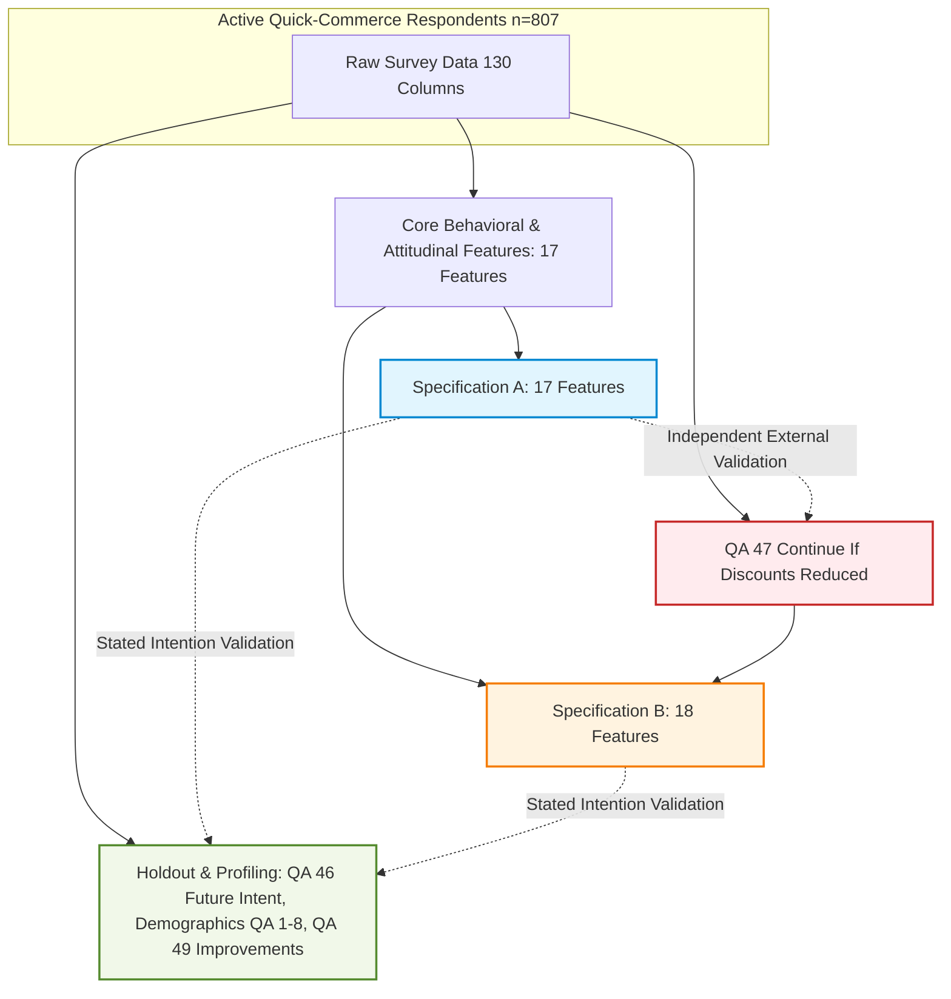

# Gate 1B Methodological Evaluation: Candidate Clustering Methodologies for Mixed Survey Data

**Project:** Beyond Discounts: Customer Segmentation and Retention Strategy for Indian Quick Commerce  
**Phase:** Gate 1B — Segmentation Feature Audit and Data Preparation  
**Target Population:** Current Active Quick-Commerce Consumers ($n = 807$; $N = 1,263$ total survey respondents)  
**Evidence Base:** Mendeley Survey Dataset (`data/raw/survey/Data.xlsx`), Code Book, Questionnaire, and Gate 1A EDA Outputs  

---

## 1. Executive Summary and Problem Context

The objective of Gate 1B is to establish a rigorous, defensible, and reproducible feature foundation for unsupervised customer segmentation in Gate 1C. Customer segmentation in this study serves a direct commercial question:
> *Which customer segments differ in their stated willingness to continue using quick commerce when discounts are reduced, and what retention interventions should platforms prioritise for each segment?*

The data structure comprises **mixed survey responses** from $n = 807$ active Indian quick-commerce shoppers. The feature inventory spans ordered Likert ratings, bounded ordered intervals (spend, frequency, tenure), nominal behavioral classifications (shopping routine role), discrete counts (platforms used), and binary indicators (volatility and uncertainty flags). 

Under classical clustering paradigms, analysts frequently submit raw integer-coded survey columns directly into Euclidean-based algorithms like ordinary $K$-means. This document demonstrates why that approach is statistically invalid for this dataset, evaluates four candidate mixed-data methodologies across five mandatory evaluation criteria, and recommends the candidate methodology for Gate 1C.

---

## 2. Inadequacy of Naive K-Means on Raw Survey Codes

Submitting raw questionnaire response codes to ordinary $K$-means is methodologically flawed for four fundamental reasons:

1. **Violation of Scale Assumptions (Distance Distortion):**  
   Euclidean distance assumes continuous, unbounded interval or ratio scales with constant unit distance. In survey data, response codes are discrete ordinal buckets or qualitative categories:
   - In **QA 19 (Items per Order)**, Code 5 represents `>10 items`, while Code 6 represents `Varies considerably`. Naive Euclidean distance would treat Code 6 as an arithmetic magnitude larger than Code 5 ($6 - 5 = 1$), assigning an arbitrary distance of $5.0$ between a 1-item shopper (Code 1) and a volatile-basket shopper (Code 6).
   - In **QA 26 (Monthly Spend)**, Code 7 represents `₹10,000 or above`, while Code 8 represents `Not sure`. Treating Code 8 as an integer would place uncertain respondents into the highest wealth bracket above ₹10,000, creating fictitious high-value segments.
   - In **QA 43 (Shopping Routine Role)**, Codes 1 to 5 represent qualitative lifestyle roles (e.g., $1 = \text{Grocery replacement}$, $4 = \text{Emergency/urgent}$). Treating these qualitative states as integers $1, 2, 3, 4, 5$ imposes a fictitious linear progression where "Emergency" is four times greater than "Grocery replacement".

2. **Centroid Degeneracy and Non-Interpretable Means:**  
   $K$-means computes cluster centers as arithmetic means across all features ($\bar{x}_k = \frac{1}{|C_k|}\sum_{i \in C_k} x_i$). For discrete Likert and nominal features, arithmetic means produce nonsensical hybrid states (e.g., a centroid with `Shopping Routine Role = 2.74` or `Monthly Spend = 4.18`). Such centroids do not correspond to any valid survey response or observable customer profile, crippling CRM interpretability.

3. **Curse of Dimensionality and Equal Variance Assumption:**  
   Standard Euclidean distance is unweighted and highly sensitive to differences in feature measurement ranges. Features measured on a 1–7 scale (QA 15, QA 25) dominate distance calculations over features on a 1–5 scale (QA 28, QA 29) or binary indicators (0/1), unless explicitly and uniformly standardized.

---

## 3. Systematic Evaluation of Candidate Methodologies

To identify a defensible segmentation methodology for Gate 1C, we evaluate four candidate mixed-data frameworks against five mandatory criteria:
1. **Respect for Mixed Data Types:** Native handling of ordinal, nominal, binary, and continuous scales.
2. **Handling of Special Categories:** Non-distorting treatment of non-ordinal options (`Varies considerably`, `Not sure`).
3. **Weighting and Redundancy Sensitivity:** Resilience to collinear inputs (e.g., satisfaction items, deal-seeking components).
4. **Computational Feasibility for $n = 807$:** Execution speed, memory footprint, and implementation complexity.
5. **CRM Interpretability:** Ability to translate cluster prototypes directly into actionable customer personas and retention levers.

---

### Comparative Evaluation Matrix

| Method | (1) Mixed Data Types | (2) Special Responses | (3) Weighting / Redundancy | (4) Scalability ($n=807$) | (5) CRM Persona Explainability | Overall Suitability |
| :--- | :--- | :--- | :--- | :--- | :--- | :--- |
| **A. Gower Distance + Partitioning Around Medoids (PAM)** | **Optimal** (natively differentiates nominal, ordinal, binary, continuous) | **Robust** (supports dual-coding: ordinal rank + binary uncertainty flag) | **Transparent** (explicit feature weight vector $w_k$; easily balances constructs) | **High** (325,221 pairs, ~2.6 MB matrix, <0.5s computation) | **Superior** (medoids are actual, observable survey respondents) | **RECOMMENDED PRIMARY** |
| **B. Gower Distance + Hierarchical Agglomerative Clustering (HAC)** | **Optimal** (uses identical verified Gower matrix) | **Robust** (identical to PAM) | **Transparent** (identical distance weighting) | **High** (sub-second dendrogram and linkage computation) | **High** (clear hierarchical taxonomy, cophenetic correlation) | **RECOMMENDED VALIDATION BENCHMARK** |
| **C. Factor Analysis of Mixed Data (FAMD) + K-Means** | **Moderate** (converts nominal to dummy coordinates; treats ordinal as continuous) | **Moderate** (treats special codes as dummy levels, increasing latent dimensionality) | **High** (orthogonal PCA components eliminate multicollinearity) | **Moderate** (requires iterative SVD/factor rotation) | **Low–Moderate** (clusters defined in abstract latent factor space) | Secondary Alternative |
| **D. Latent Class Analysis (LCA / Mixture Models)** | **High** (probabilistic mixture over multinomial distributions) | **High** (treats all codes as multinomial categorical states) | **Moderate** (local independence assumption violated by correlated items) | **Low** (EM algorithm prone to local maxima and convergence instability) | **Moderate** (probabilistic assignment, but complex latent class tables) | Excluded (unnecessary model complexity) |

---

## 4. Deep-Dive on Recommended Methodology: Gower Distance + PAM

### 4.1. Mathematical Formulation
Gower's general dissimilarity coefficient $S_{ij}$ between two respondents $i$ and $j$ across $p$ features is formulated as:
$$D_{ij} = 1 - S_{ij} = 1 - \frac{\sum_{k=1}^p w_k s_{ijk}}{\sum_{k=1}^p w_k \delta_{ijk}}$$

where:
- $\delta_{ijk} = 1$ if feature $k$ is validly observed for both respondents, and $0$ otherwise.
- $w_k \in [0, 1]$ is the user-defined analytical weight assigned to feature $k$.
- The partial similarity $s_{ijk}$ respects the variable's verified data type:
  - **Nominal Variables** (`shopping_routine_role`):
    $$s_{ijk} = \begin{cases} 1 & \text{if } x_{ik} = x_{jk} \\ 0 & \text{if } x_{ik} \neq x_{jk} \end{cases}$$
  - **Binary Indicators** (`monthly_spend_not_sure`, `items_varies_considerably`):
    $$s_{ijk} = \begin{cases} 1 & \text{if } x_{ik} = x_{jk} \\ 0 & \text{if } x_{ik} \neq x_{jk} \end{cases}$$
  - **Ordinal & Continuous Variables** (`order_frequency`, `order_spend`, `discount_overspend`, `service_satisfaction_composite`):
    $$s_{ijk} = 1 - \frac{|x_{ik} - x_{jk}|}{R_k}$$
    where $R_k = \max(x_k) - \min(x_k)$ is the observed active range of feature $k$. This scales all ordinal and interval differences strictly into $[0, 1]$.

### 4.2. Handling Special Categories Without Distorting Order
For features with non-ordinal options:
- **QA 19 (Items per Order):** Substantive basket levels 1–5 are mapped to an ordinal scale ($R = 4$), with Code 6 respondents assigned the neutral sample median rank ($3.0 = \text{4–5 items}$). Concurrently, a binary indicator `items_varies_considerably` captures volatility.
- **QA 26 (Monthly Spend):** Substantive spend levels 2–7 are mapped to ordinal ranks 1–6 ($R = 5$), with Code 8 assigned the neutral sample median rank ($2.0 = \text{₹1,000–₹2,499}$). Concurrently, a binary indicator `monthly_spend_not_sure` captures spend uncertainty.
This dual-coding guarantees that distance calculations reflect true purchasing magnitude among defined spenders while explicitly penalizing or grouping respondents who share spending uncertainty.

### 4.3. Addressing Redundancy and Multi-Item Overweighting
In Gate 1A, four satisfaction items (QA 37 Overall, QA 38 Product Quality, QA 39 Delivery Reliability, QA 40 Value for Money) exhibited high inter-item correlations ($r \in [0.53, 0.71]$) and an overall Cronbach's alpha of $\alpha = 0.863$.
- If entered as 4 separate features, general satisfaction would command $4 / 17 \approx 23.5\%$ of the total distance metric, causing clusters to be dominated simply by "satisfied vs dissatisfied" sentiment.
- In our feature design, we collapse these into a single unidimensional `service_satisfaction_composite` (mean of QA 37–40), giving customer satisfaction exactly $1 / 17 \approx 5.9\%$ of the feature weight.
- Conversely, `discount_overspend` (QA 28) and `threshold_extra_items` (QA 29) exhibited a correlation of only $r = 0.063$. They measure distinct mechanisms (promo-driven impulse buying vs rational fee-avoidance gaming). Both are preserved as separate features to ensure multidimensional price-sensitivity representation.

### 4.4. Computational Feasibility for $n = 807$
For the active cohort ($n = 807$):
- Pairwise distance matrix size: $\frac{n(n-1)}{2} = \frac{807 \times 806}{2} = 325,221$ unique pairwise distances.
- Memory requirement: A condensed 1D distance vector in `float64` requires only $2.60\text{ MB}$ of RAM.
- Computation time: Gower matrix computation executes in under $0.4\text{ seconds}$ in standard NumPy/SciPy on standard hardware.
- PAM optimization: $k$-Medoids converges in $<1.5\text{ seconds}$ for candidate clusters $k \in [3, 6]$.

### 4.5. CRM Explainability via Actual Medoids
Unlike $K$-means centroids, PAM selects **actual survey respondents** (medoids) that minimize the total dissimilarity to all other cluster members:
$$m_k = \arg\min_{i \in C_k} \sum_{j \in C_k} D(i, j)$$
Because the medoid is an actual customer record, CRM strategists can inspect the exact real-world survey response profile (e.g., "Respondent #412: Orders 2–3 times/week, spends ₹2,500–₹5,000/month, highly sensitive to threshold delivery fees, highly satisfied with speed, primarily uses Blinkit"). This produces authentic customer personas directly linked to targeted commercial interventions.

---

## 5. Specification A vs Specification B Architecture

To eliminate circular validation risks, two explicit feature specifications have been formalized:

1. **Specification A (Independent Discount-Sensitivity Evaluation):**
   - **Clustering Inputs:** 17 features (order velocity, basket items, spend tier, spend uncertainty flag, basket volatility flag, promo overspend, threshold gaming, platform price comparison, physical price comparison, fast delivery importance, service satisfaction composite, shopping routine role, platforms used count, unplanned purchase, new brand trial).
   - **QA 47 Role:** Strictly EXCLUDED from clustering inputs. Reserved as the primary external validation benchmark to test whether clusters formed from general shopping habits naturally diverge in stated discount resilience.
   - **Hypothesis Tested:** "Do distinct behavioural and attitudinal customer segments inherently possess differing levels of stated discount sensitivity without using discount sensitivity to create the clusters?"

2. **Specification B (Discount-Intention Included):**
   - **Clustering Inputs:** 18 features (Specification A + QA 47 `Continue If Discounts Reduced`).
   - **QA 47 Role:** Segment-defining input.
   - **Methodological Boundary:** Because QA 47 directly guides cluster partitioning, differences in QA 47 across resulting segments **cannot be presented as independent external validation** (circular logic). Differences must be reported as construct-defining properties.

3. **Universal Holdout Rules (Specification A and B):**
   - **QA 46 (Next 3 Month Use):** Held out from both specifications as a benchmark for stated future-use intention. Explicitly bounded as self-reported intention, not realized retention.
   - **Demographics (QA 1–8):** Reserved for post-cluster profiling to prevent clusters from degenerating into demographic stereotypes.
   - **Platform-Specific Indicators (QA 12 dummies):** Reserved for profiling to avoid tying segments to single brand names.
   - **QA 49 (Preferred Improvement):** Reserved for post-cluster retention strategy mapping.

---

## 6. Execution Roadmap for Gate 1C

In Gate 1C, the implementation pipeline will:
1. Load prepared feature matrices `segmentation_spec_a.csv` and `segmentation_spec_b.csv`.
2. Compute the exact Gower distance matrix using normalized feature ranges.
3. Test candidate cluster solutions across $k \in \{3, 4, 5, 6\}$ using PAM ($k$-Medoids).
4. Run Hierarchical Agglomerative Clustering (HAC with average and Ward-equivalent linkage) to assess hierarchical cluster stability and inspect dendrogram topology.
5. Evaluate cluster quality using Average Silhouette Width, Hubert's $\Gamma$, within-cluster medoid dispersion, and bootstrap stability (Jaccard similarity).
6. Cross-tabulate candidate segments against held-out QA 47 (for Spec A), QA 46 (for Spec A and B), and QA 49 to evaluate CRM actionability and discount-retention strategies.
